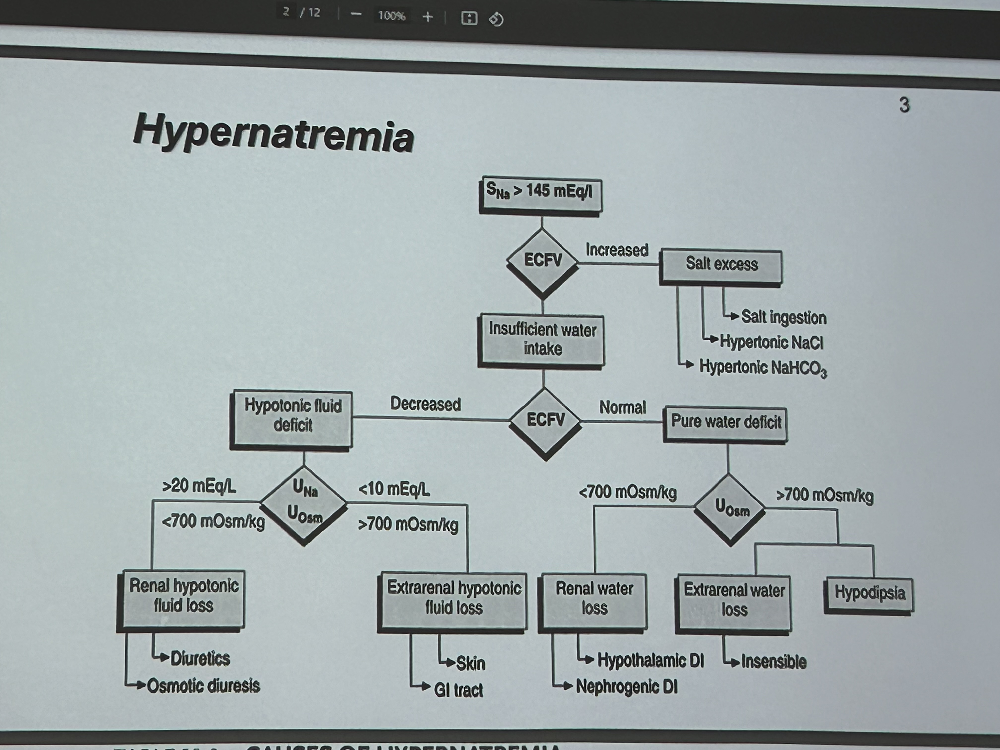

# Hypernatremia

> 📖 **Tintinalli**：[Ch17 › Hypernatremia](https://drive.google.com/file/d/1a-UzTzGmfSBG-YvuYR0bdj88z3xw1scr/view)

> Source: Heptabase「🔎高血鈉(Hypernatremia)」
> Related: [Hyponatremia & SIADH](低血鈉與SIADH.md)、[IV Fluids](輸液.md)

## Key Points
- 大部分都是 **salt excess**！！因為 Na 高 osm 都會很高，人都會很想要喝水或是分泌 ADH，所以通常都是不能自己喝水的人，或是 DI
- **Lasix**：脫水比脫 Na 還要多，所以會**高血鈉**
- Thiazide：可以排 Na 較多，排水較少
- Pituitary gland 被傷到 ⇒ DI
- 正常 serum blood 超過 250，小便就會看到糖！（用 SGLT2-i 會更容易看到糖）

### Hypernatremia 流程（Heptabase 圖片，上課翻拍）
🖼️ 圖片轉錄
- SNa >145 mEq/L → ECFV？
  - Increased → **Salt excess**：salt ingestion、hypertonic NaCl、hypertonic NaHCO3
  - 否則 → Insufficient water intake → ECFV？
    - Decreased → **Hypotonic fluid deficit** → UNa／UOsm
      - UNa >20 mEq/L、UOsm <700 mOsm/kg → renal hypotonic fluid loss：diuretics、osmotic diuresis
      - UNa <10 mEq/L、UOsm >700 mOsm/kg → extrarenal hypotonic fluid loss：skin、GI tract
    - Normal → **Pure water deficit** → UOsm
      - <700 mOsm/kg → renal water loss：hypothalamic DI、nephrogenic DI
      - >700 mOsm/kg → extrarenal water loss（insensible）；hypodipsia

## Management
- Na 如果 >160 不要突然洗腎，因為 Na 突然變很低，會 brain edema 或是 seizure（洗腎的話要洗 CRT）⚠️ 原文如此，待查證（可能指 CRRT）
- 如果 BUN/Cr 很高而且是 prerenal 感覺 ＋ Na 很高 ⇒ 先 hydration，如果 hydration 之後開始腫，就要洗腎了（不要用 albumin，因為病人尿不出來，你把液體拉回血管內也沒用）

## Medications
（待補）

## Disposition
（待補）

## Clinical Pearls
（待補）
