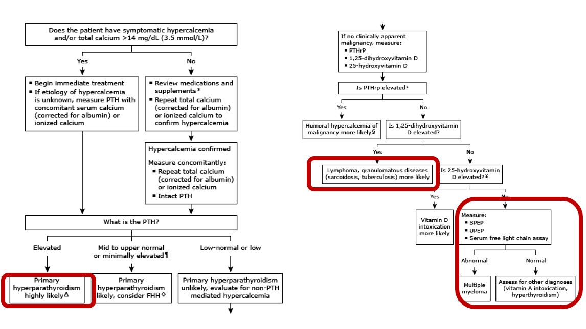
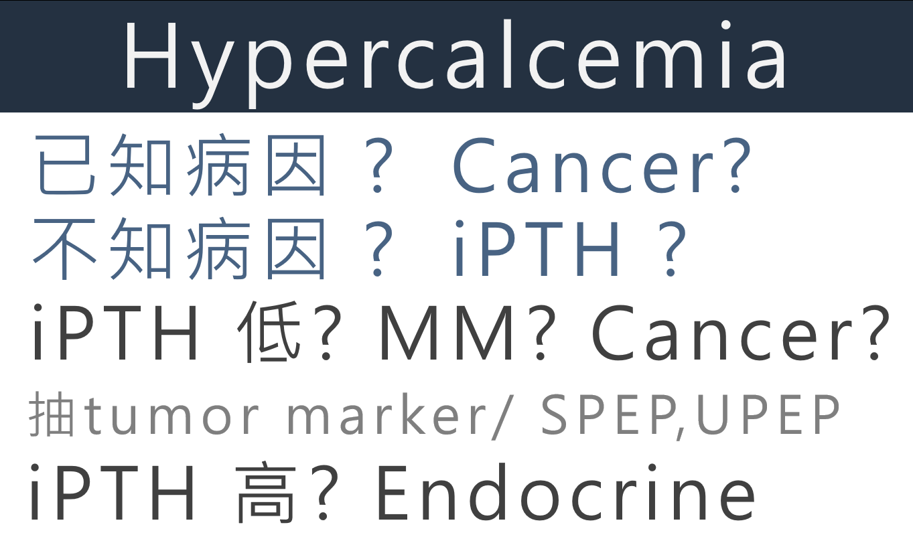
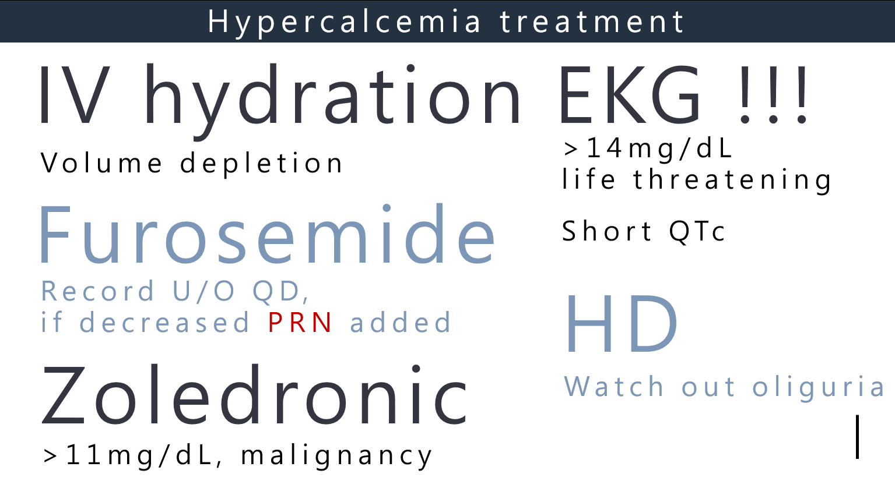
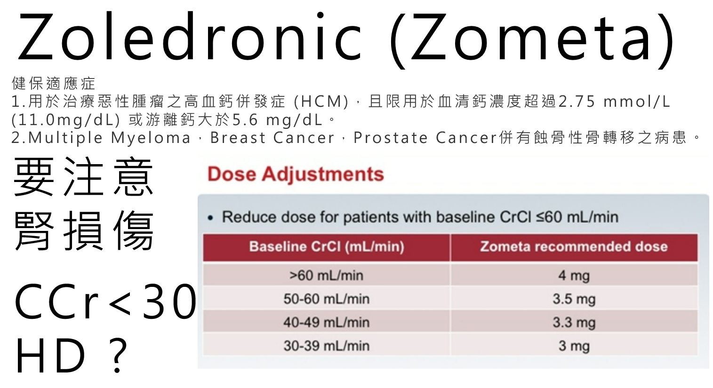

# Hypercalcemia

> Source: 林口長庚急診 OBN survival guide「不可不知的 Hypercalcemia 鑑別診斷及治療」（原文都是圖，[原文](https://lnkemergency.xms.tw/media/1288)，需登入）
> Related: [內分泌急症](內分泌急症.md)、[Tumor Lysis Syndrome](../09_Hema%20&%20Oncology/Tumor_Lysis_Syndrome.md)

## 鑑別診斷

🖼️ 圖片轉錄（hypercalcemia 診斷流程）
1. 有症狀，或 total Ca **>14 mg/dL**（3.5 mmol/L）？
   - 是 → **立即開始治療**；病因不明的話，驗 PTH，同時驗 serum Ca（albumin 校正）或 ionized Ca
   - 否 → 檢視藥物和補充品；重測 total Ca（albumin 校正）或 ionized Ca 確認 → 確認 hypercalcemia 後同時驗 Ca 和 **intact PTH**
2. 看 **PTH**
   - **升高** → **primary hyperparathyroidism** 很可能
   - 正常偏高或輕微升高 → primary hyperparathyroidism 可能，考慮 FHH
   - **正常偏低或低** → 不太像 primary hyperparathyroidism，找 non-PTH mediated 原因
3. 沒有明顯 malignancy → 驗 **PTHrP、1,25-dihydroxyvitamin D、25-hydroxyvitamin D**
   - **PTHrP 升高** → humoral hypercalcemia of malignancy
   - **1,25-(OH)₂ vitamin D 升高** → **lymphoma、granulomatous disease（sarcoidosis、TB）**
   - **25-OH vitamin D 升高** → vitamin D intoxication
   - 都沒有 → 驗 **SPEP、UPEP、serum free light chain**：異常 → **multiple myeloma**；正常 → 找其他診斷（vitamin A intoxication、hyperthyroidism）

🖼️ 圖片轉錄（急診簡化版）
- 已知病因？→ cancer？
- 不知道病因？→ 驗 **iPTH**
  - **iPTH 低** → multiple myeloma？cancer？⇒ 抽 tumor marker、SPEP、UPEP
  - **iPTH 高** → endocrine

## 治療

🖼️ 圖片轉錄
- **IV hydration**：病人通常 volume depletion
- **EKG！！！**：>14 mg/dL 是 ***life threatening***；看 **short QTc**
- **Furosemide**：每天記錄 urine output，減少時 PRN 加上
- **Zoledronic acid**：Ca **>11 mg/dL** 且 malignancy
- **HD**：注意 oliguria

### Zoledronic acid（Zometa）

🖼️ 圖片轉錄
- **健保適應症**
  1. 治療惡性腫瘤的高血鈣併發症（HCM），且限血清鈣 **>2.75 mmol/L（11.0 mg/dL）** 或游離鈣 >5.6 mg/dL
  2. Multiple myeloma、breast cancer、prostate cancer 併有蝕骨性骨轉移
- ***要注意腎損傷***：CCr <30 → 考慮 HD？
- Baseline CrCl ≤60 mL/min 要減量：

| Baseline CrCl（mL/min） | Zometa 建議劑量 |
|---|---|
| >60 | 4 mg |
| 50–60 | 3.5 mg |
| 40–49 | 3.3 mg |
| 30–39 | 3 mg |

## Clinical Pearls
- 不知道原因的高血鈣，先驗 iPTH：低 → 想 MM／cancer；高 → endocrine
- Ca >14 mg/dL 有生命危險，記得做 EKG
