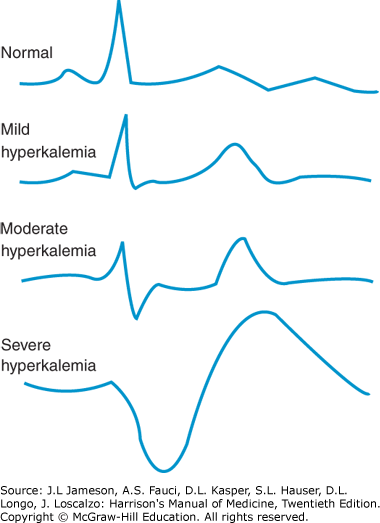
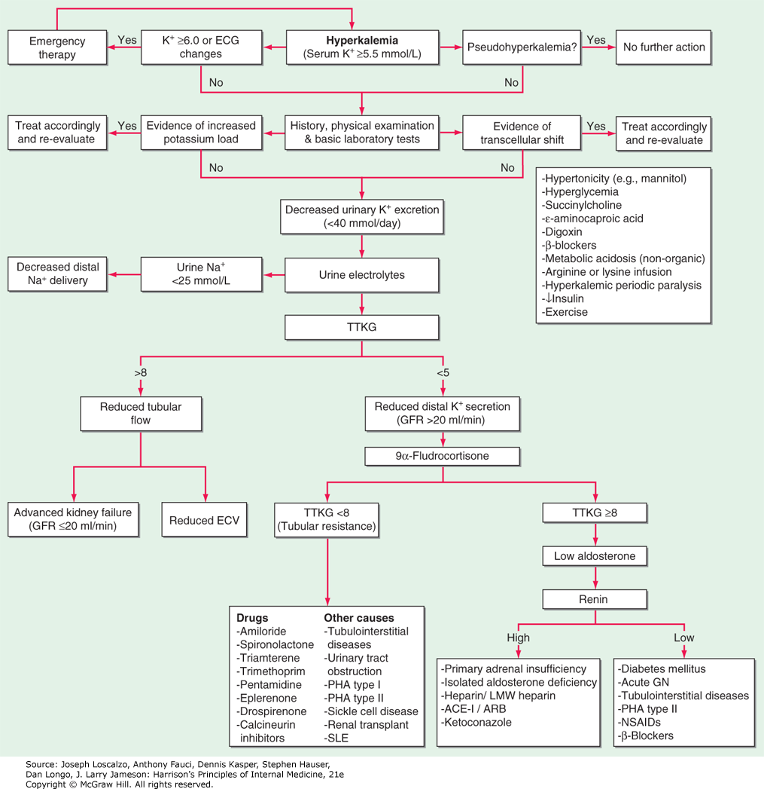

# Hyperkalemia

> 📖 **Tintinalli**：[Ch17 › Hyperkalemia](https://drive.google.com/file/d/1BMI5PbU3LiZyPaVYKiinkB6pZGWNw7tE/view)

> Source: Heptabase「🔎 高血鉀(Hyperkalemia)」白板（高血鉀(Hyperkalemia)的治療、危急性高血鉀、表現、TTKG、鉀離子的平衡）「Insensible loss」卡片「2025-12-17」
> Related: [Hypokalemia & Potassium Disorders](低血鉀與鉀離子.md)（Hyperkalemia EKG 演變）、[EKG Interpretation](../02_心血管/EKG判讀.md)（HATW）

## Key Points

### 表現
- Weakness、nausea、paresthesia（感覺異常）、palpitation
- EKG 變化（圖片：normal → mild → moderate → severe hyperkalemia）

  

### 危急性高血鉀
1. K >6
2. 明顯肌肉無力／癱瘓
3. EKG 有變化
4. 腎功能不全者 ＋ K >5.5 且高血鉀成因持續存在
- ⇒ 符合急洗腎 indication

### TTKG
- TTKG = (Uk × Posm) / (Pk × Uosm)

### Hyperkalemia 流程（Harrison's 21e）

## Management
- 如果遇到 hyper-K → 先做 EKG
- 大量輸血：要小心 Ca 低和 K 高（Heptabase 2025-12-17）

## Medications

### 高血鉀的治療：Stabilize、Redistribute、Eliminate
- **Stabilize**
  - CaCl／Ca gluconate
- **Redistribute**
  - Insulin（+ glucose）
  - HCO3 → 讓血液變鹼，把 K shift 進去、H⁺ shift 出來
  - **Beta-2 agonist** → 刺激 Na⁺/K⁺ ATPase（鈉出鉀進）
- **Eliminate**
  - K-binding resins：Kalimate
  - 利尿劑（Furosemide）：因為是 loop diuretic，抑制 NKCC，會降 Na、**K**、Mg、Ca
  - 洗腎

## Disposition
- 危急性高血鉀 ⇒ 符合急洗腎 indication（見上）

## Clinical Pearls
（待補）
