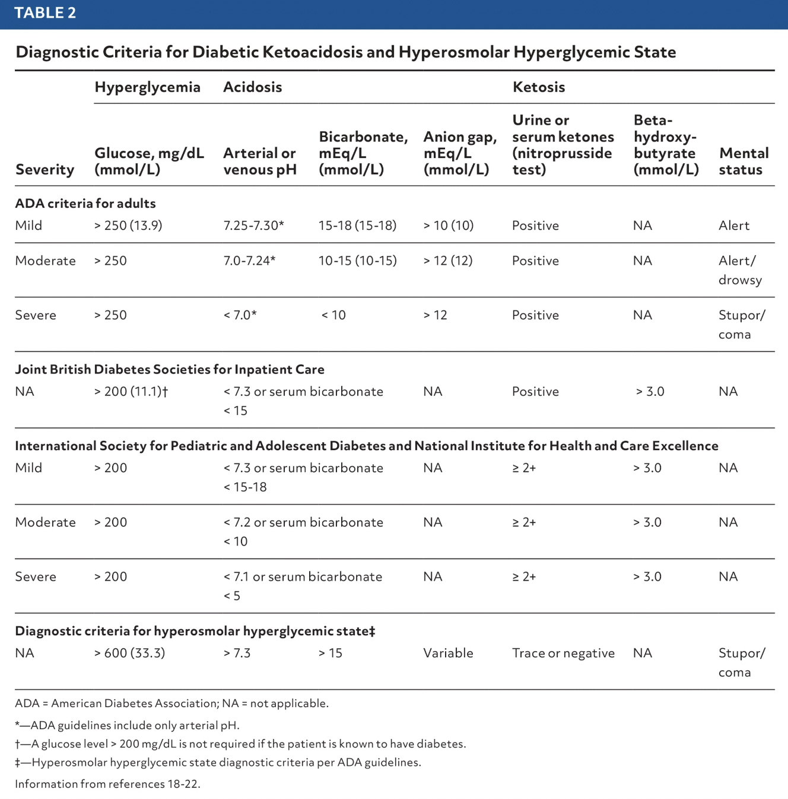
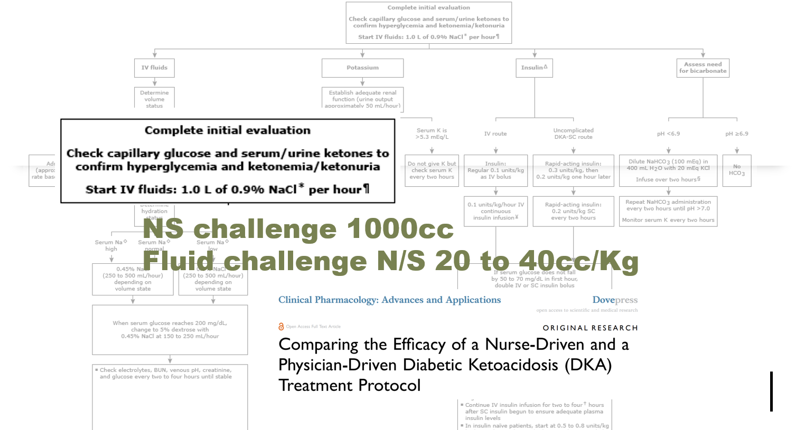
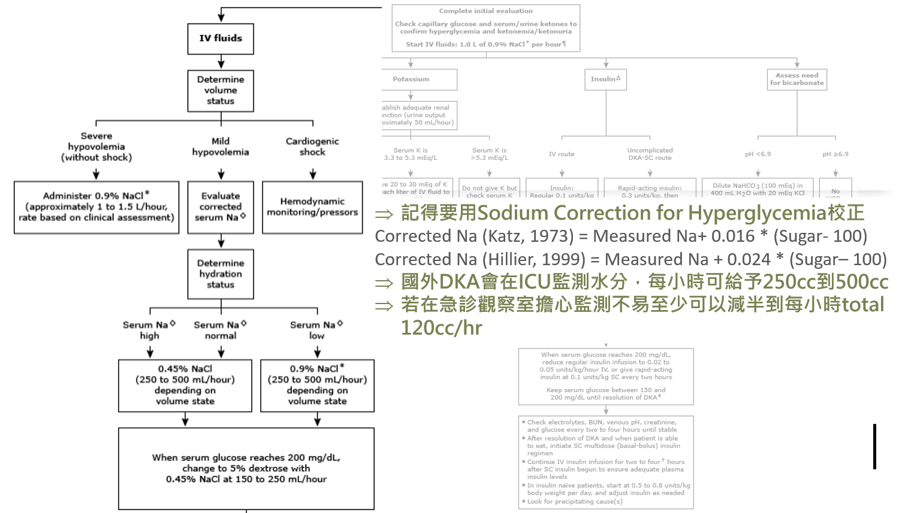
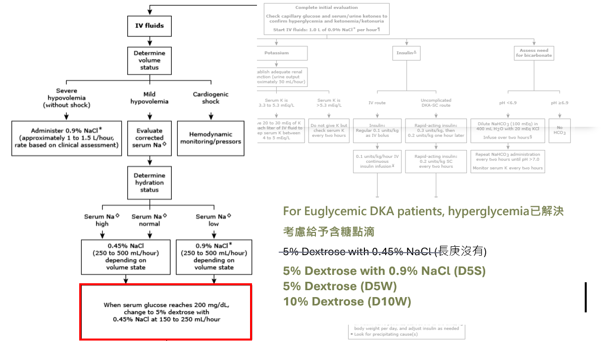
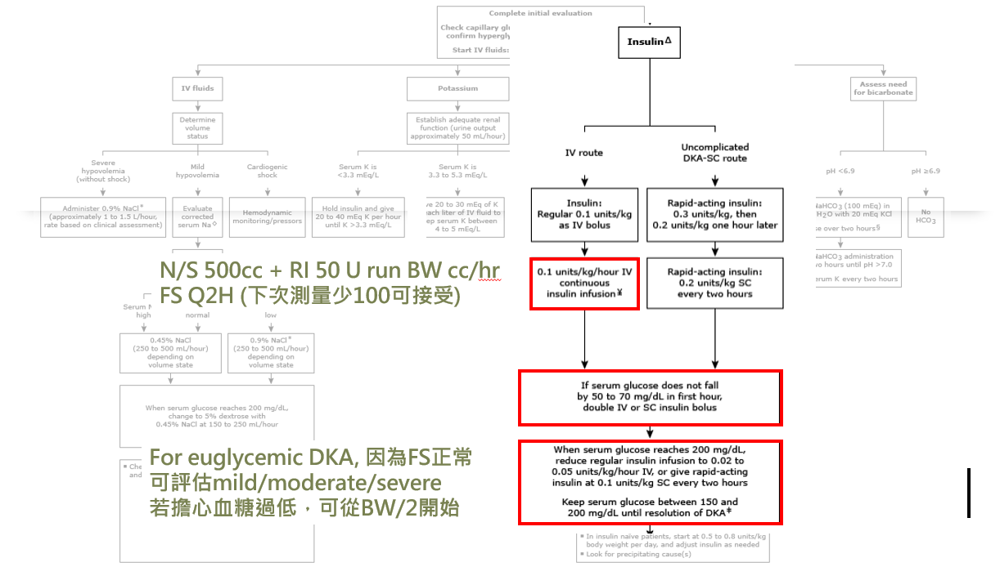
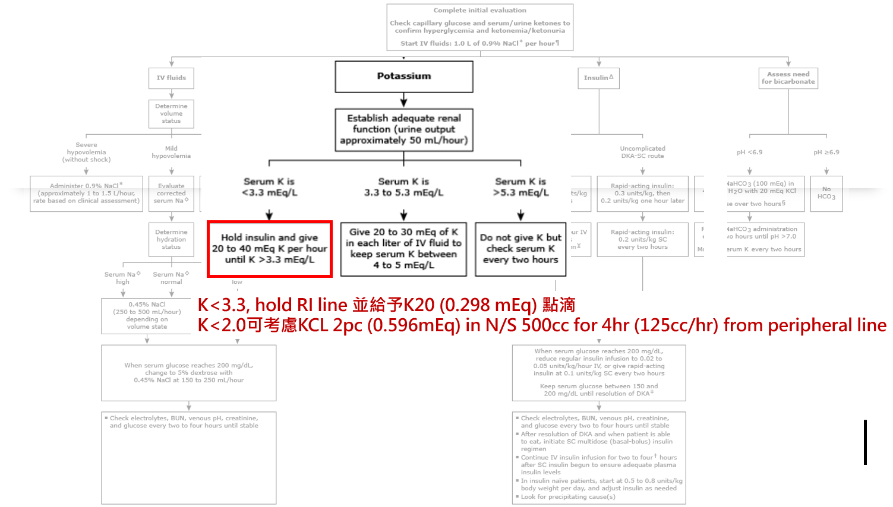
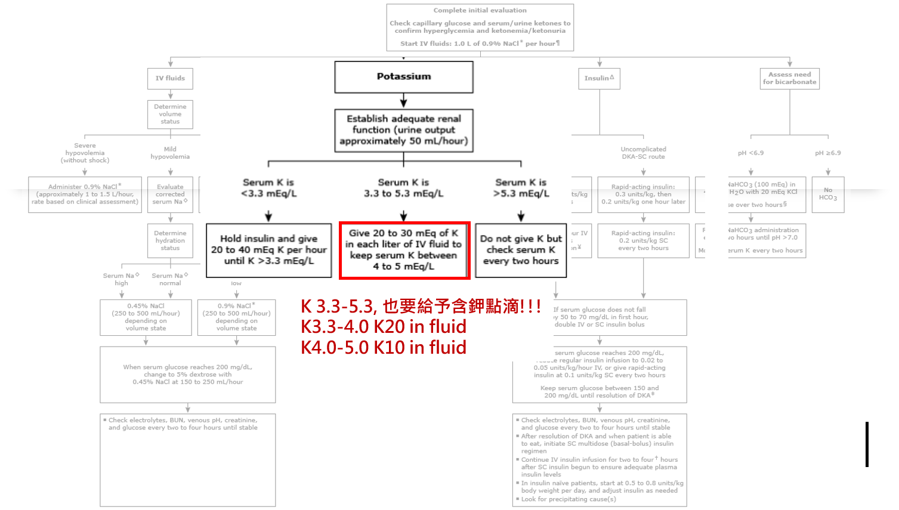
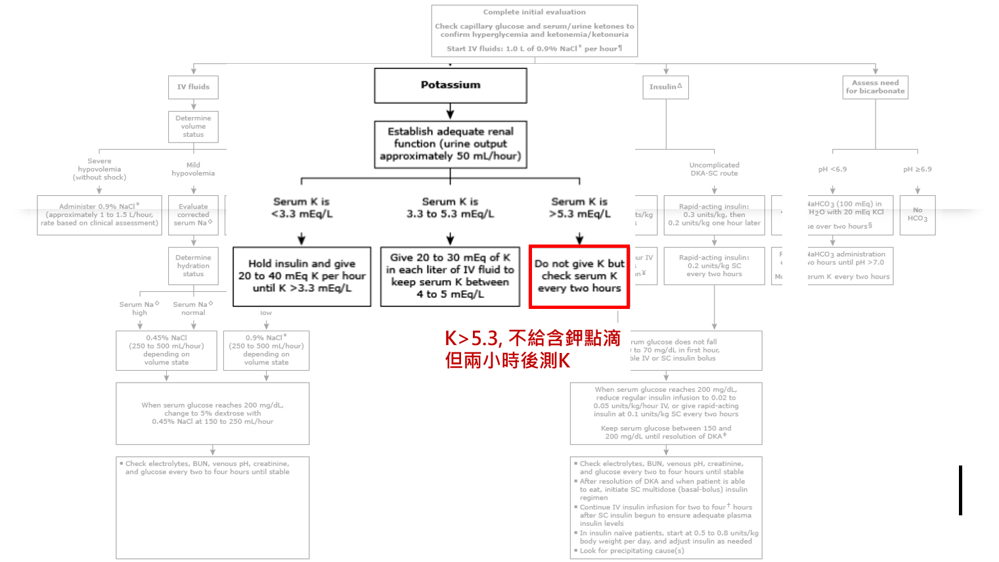
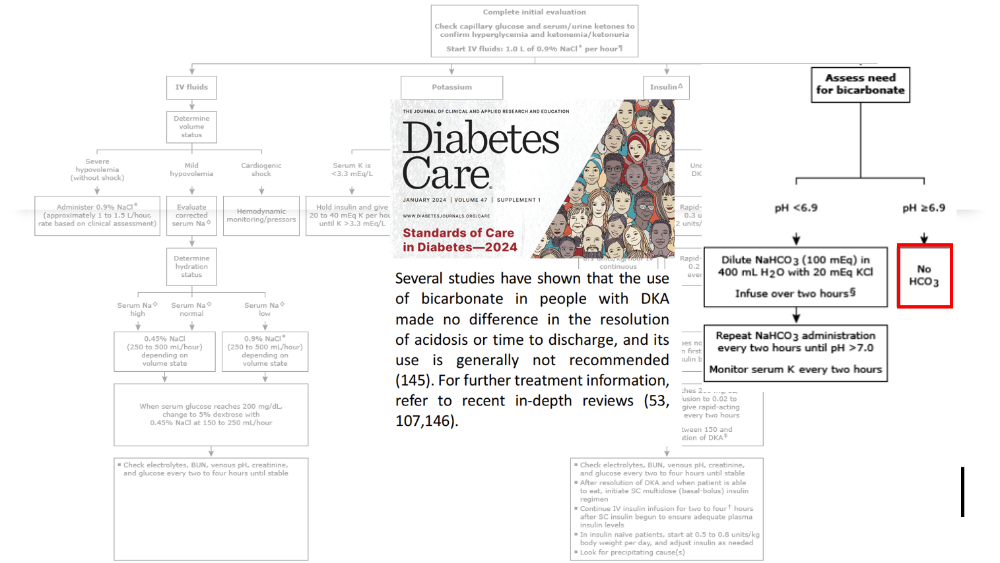

# DKA & HHS

> 📖 **Tintinalli**：[Ch225 Diabetic Ketoacidosis](https://drive.google.com/file/d/1FXeHaGiCrE73zVDQhJ8Hie_TW0dydosU/view)｜[Ch227 Hyperosmolar Hyperglycemic State](https://drive.google.com/file/d/1_AukpGY-HsPAbLarUHoGvu9opS-DNe8a/view)

> Source: Heptabase「DKA」「2025-12-22（EDKA）」；林口長庚急診 OBN survival guide「[DKA/HHS 正確診斷/治療/resolution 如何處理](https://lnkemergency.xms.tw/media/1299)」

## 誘發因子（Heptabase）
- DKA 的誘發因子（**6I**）
  - Insulin deficiency
  - Iatrogenic（類固醇、SGLT2i）
  - **Infection**
  - Inflammation（pancreatitis、cholecystitis）
  - Ischemia/Infarction（AMI、cerebral、gut）
  - Intoxication（酒精、藥物）
- SGLT2 造成 EDKA（sugar 不高）（Heptabase 2025-12-22）

## 診斷
- **診斷 DKA／HHS 請先確認病人整體狀況，只照 lab 數字診斷病人是很危險的**
  - 如：septic shock 的病人可同時有血糖高 + 代謝性酸中毒 + poor intake ketosis
  - 許多單純 DM poor control 被上 RI line，一下就低血糖，這對病人有害！
- **高血糖不會死人，但低血鉀會**
> [!pearl] DKA 診斷標準（ADA，缺一不可）
> - Serum glucose **>250 mg/dL**（13.9 mmol/L）（懷疑 euglycemic DKA 需有糖尿病史）
> - Serum or urine ketone positive
> - Blood gas **pH <7.30**
> - Serum **HCO3⁻ <18 mEq/L**
- DKA 嚴重度：輕度 pH 7.25–7.30、HCO3⁻ 15–18；中度 pH 7.0–7.24、HCO3⁻ 10–15；重度 pH <7.0、HCO3⁻ <10
- 約 **10%** 的 DKA 是 **euglycemic DKA**（glucose <200–250 mg/dL），可發生在食物攝取減少、懷孕、飲酒、肝衰竭或 SGLT2 抑制劑治療期間
> [!pearl] HHS 診斷標準（缺一不可)
> - Serum glucose **>600 mg/dL**（33.3 mmol/L）
> - Effective plasma osmolality **>320 mOsm/kg**
> - Blood gas pH >7.30、HCO3⁻ >15 mEq/L *（排除DKA）*
> - Trace or negative ketones
> - 常出現精神狀態改變，從嗜睡到昏迷
- DKA、HHS、DM poor control 都有 2 個共同問題：**hyperglycemia、dehydration**
  - 差別在 DKA 身體沒有 insulin，利用 fatty acid 產生 ketone body ⇒ acidosis
  - 酮體：血液驗的 β-hydroxybutyrate（BHB）、尿液驗的 acetoacetic acid；BHB 較快可以測得
- JBDS：DKA 的病人會**缺水、缺鹽、缺鉀**；typical DKA adult deficits：water 100 mL/kg、Na 7–10 mmol/kg、Cl 3–5 mmol/kg、K 3–5 mmol/kg

🖼️ 圖片轉錄（Table 2. Diagnostic criteria for DKA and HHS）
| 標準 | 嚴重度 | Glucose（mg/dL） | pH | HCO3⁻ | Anion gap | Ketones | BHB（mmol/L） | Mental status |
|---|---|---|---|---|---|---|---|---|
| ADA（成人） | Mild | >250 | 7.25–7.30 | 15–18 | >10 | Positive | NA | Alert |
| | Moderate | >250 | 7.0–7.24 | 10–15 | >12 | Positive | NA | Alert／drowsy |
| | Severe | >250 | <7.0 | <10 | >12 | Positive | NA | Stupor／coma |
| JBDS（住院） | — | >200 | <7.3 或 HCO3⁻ <15 | | NA | Positive | >3.0 | NA |
| ISPAD／NICE（兒童） | Mild | >200 | <7.3 或 HCO3⁻ <15–18 | | NA | ≥2+ | >3.0 | NA |
| | Moderate | >200 | <7.2 或 HCO3⁻ <10 | | NA | ≥2+ | >3.0 | NA |
| | Severe | >200 | <7.1 或 HCO3⁻ <5 | | NA | ≥2+ | >3.0 | NA |
| HHS（ADA） | — | >600 | >7.3 | >15 | Variable | Trace／negative | NA | Stupor／coma | 

- ADA guideline 只用 arterial pH；已知有糖尿病的人不需要 glucose >200 mg/dL

## 治療（OBN）
- 參考：ADA guideline、英國 JBDS guideline（[JBDS DKA guideline 2023](https://abcd.care/sites/default/files/site_uploads/JBDS_Guidelines_Current/JBDS_02_DKA_Guideline_with_QR_code_March_2023.pdf)）
- ⭐ **絕對不要在 finger show high、沒有 lab data 的病人 bolus RI**
  - 小孩：absolute contraindication，容易 cerebral edema
  - 大人：要先確定沒有 hypokalemia，不然 arrhythmia 後 IHCA
- 原則上 **fluid resuscitation 優先於 insulin**

### 輸液
- **DKA**
  - 選 Normal saline（evidence 上 Lactated Ringer's 是 DKA 更好的選擇，只是多數 guideline 尚未更新）
  - 成人：**有休克** N/S（L-R）500 mL bolus，repeat Q10–15 min for 1 hr；**無休克** N/S（L-R）1000 mL run 1 hr
  - 兒童：初始 30 分鐘內 10 mL/kg（max 75 kg）N/S（L-R），之後依體重與需求維持
  - 之後依 volume status，250–500 mL/hr for 24–48 hr；可選 half saline 0.45%／NS 0.9%／L-R；觀察室人力有限無法一直監測，或病人體型小怕 overload，可適當減量
- **HHS**：積極給水
  - ADA：0.9% N/S **15–20 mL/kg/h 或 1–1.5 L/hr**；預期脫水量為體重 12–15%；前 48 hr 成人平均需要 **9000 mL** N/S（比想像多很多；要不要用 L-R：作者認為可以，但目前沒有 evidence）
  - **考慮延遲 insulin**：HHS 灌水後血糖多半明顯改善（預期每小時降 100–150 mg/dL）；補液後血糖下降不足（<50 mg/dL/hr）再加 RI；實務上可寫 RI line 延遲 2–4 hr，確認血糖後再給
  - 各學會建議不同：JBDS 建議最初 12 小時補充約 50% 估計體液流失量，也接受 3–8 mOsm/kg/h 的滲透壓變化速率；ADA 標準是 <3 mOsm/kg/h

🖼️ 圖片轉錄（ADA 流程圖 IV fluids 分支＋投影片註解）
- Complete initial evaluation：測 capillary glucose 和 serum／urine ketones 確認 hyperglycemia 與 ketonemia／ketonuria；**start IV fluids：0.9% NaCl 1.0 L/hr**
  - 投影片註解：NS challenge 1000 cc；fluid challenge N/S 20–40 cc/kg
- 評估 volume status
  - Severe hypovolemia（沒有 shock）→ 0.9% NaCl 約 1–1.5 L/hr，依臨床評估
  - Mild hypovolemia → 算 corrected serum Na → 評估 hydration status：Na 高或正常 → **0.45% NaCl 250–500 mL/hr**；Na 低 → **0.9% NaCl 250–500 mL/hr**
  - Cardiogenic shock → hemodynamic monitoring／pressors
- 血糖降到 **200 mg/dL** → 改 **5% dextrose with 0.45% NaCl 150–250 mL/hr**
- 每 2–4 小時驗 electrolytes、BUN、venous pH、creatinine、glucose 直到穩定
- 投影片註解
  - 記得用 **Sodium correction for hyperglycemia** 校正
    - Katz（1973）：Corrected Na = measured Na + 0.016 × (sugar − 100)
    - Hillier（1999）：Corrected Na = measured Na + 0.024 × (sugar − 100)
  - 國外 DKA 會在 ICU 監測水分，每小時可給 250–500 cc；急診觀察室擔心監測不易，至少可以減半到每小時 total 120 cc/hr
  - **Euglycemic DKA**：hyperglycemia 已解決，考慮給含糖點滴：D5S（5% dextrose with 0.9% NaCl）、D5W、D10W

### Insulin
- **DKA**
  - 成人：RI 起始 **0.1 U/kg/hr**；目標 FS 每小時降 50 mg/dL、HCO3 每小時 +3 mmol/L，未達標每小時增加 1U；血糖到 **250 mg/dL** 時減量到 **0.05 U/kg/hr**
  - 兒童：確認 fluid resuscitation 完成，**不可 RI bolus**；起始 0.05–0.1 U/kg/hr（年紀較小、沒那麼嚴重從低劑量；青少年、嚴重 DKA 從高劑量）
  - 早期皮下打長效胰島素（glargine）可以更快緩解 DKA，也更容易過渡到 SC insulin
  - 血糖到 250 mg/dL **不代表可以停 RI line／fluid**，要繼續到酸血症、ketone、症狀都過關；此時點滴換含糖點滴
- **HHS**：各指引差異大
  - 成人：JBDS 建議 0.05 U/kg/hr，依需求每小時加 1.0 U；ADA 建議 0.1 U/kg/hr
  - 兒童：輸液無法使血糖充分下降（<50 mg/dL/hr）才考慮 RI；起始 0.025–0.05 U/kg/hr，目標每小時降 50–75 mg/dL；不可 bolus；血糖每小時降 >100 mg/dL 應暫停 insulin
  - 與 DKA 需要立即開始 RI 不同，**HHS 早期 RI 可能不必要且有害**：單純補液就會因稀釋、腎灌流改善、組織攝取增加讓血糖大幅下降；葡萄糖的滲透壓幫忙維持嚴重脫水病人的血管內容積，胰島素讓血糖和滲透壓快速下降可能導致循環受損和血栓栓塞

- **IV route**：regular insulin 0.1 U/kg IV bolus → **0.1 U/kg/hr** continuous infusion
- **Uncomplicated DKA－SC route**：rapid-acting insulin 0.3 U/kg，1 小時後 0.2 U/kg → 之後 0.2 U/kg SC Q2H
- 第一個小時血糖沒有降 50–70 mg/dL → IV 或 SC insulin bolus 加倍
- 血糖到 **200 mg/dL** → regular insulin 減到 **0.02–0.05 U/kg/hr** IV，或 rapid-acting insulin 0.1 U/kg SC Q2H；血糖維持 **150–200 mg/dL** 直到 DKA 緩解
- 投影片註解
  - N/S 500 cc + RI 50 U run BW cc/hr；FS Q2H（下次測量少 100 可接受）
  - Euglycemic DKA：FS 正常，可依 mild／moderate／severe 評估；擔心血糖過低，可從 BW/2 開始

### 鉀離子
- Insulin 會讓 K shift 到細胞內，serum K 迅速下降；DKA／HHS 病人雖然 serum K 通常正常或偏高，**體內總鉀其實嚴重不足**
  - 研究：DKA 病人約 16.6% 低血鉀、61.6% 正常、21.7% 高血鉀
- 依起始 serum K 決定：
  - **K <3.3**：**暫停 insulin**，先補鉀，以 20–30 mEq（/hr）補充，直到 K ≥3.3
  - **K 3.3–5.3**：可以用 insulin，同時 IVF 每公升加 **20–30 mEq**，維持 K 4–5
  - **K >5.3**：可以用 insulin，不用立即補鉀，**Q2H check K**
- 治療期間 K 變化很快，需 Q2H 監測；超出正常範圍考慮每小時監測（實務上可能有困難）
- Q：DKA 合併低血鉀可以口服補 K 嗎？A：**不行**，指引明確建議在 IVF 中補 K（代謝紊亂、GI 問題，口服無法精確計算、吸收不定）

🖼️ 圖片轉錄（K <3.3 的投影片註解）
- K <3.3：**hold RI line**，並給 K20 點滴
- K <2.0：可考慮 KCl 2 pc in N/S 500 cc，run 4 hr（125 cc/hr），from peripheral line
- ⚠️ 原文如此，待查證：K20 後面標「0.298 mEq」、KCl 2 pc 標「0.596 mEq」，單位或數值看起來不對

🖼️ 圖片轉錄（ADA 流程圖的 potassium 分支＋投影片註解）
- 先確認腎功能足夠（urine output 約 50 mL/hr）
- K <3.3：hold insulin，每小時給 20–40 mEq K 直到 K >3.3
- K 3.3–5.3：每公升 IV fluid 加 20–30 mEq K，維持 K 4–5 ⇒ **也要給含鉀點滴！K 3.3–4.0 用 K20 in fluid；K 4.0–5.0 用 K10 in fluid**
- K >5.3：不給 K（不給含鉀點滴），但兩小時後測 K
- ⚠️ 原文如此，待查證：文字寫 K <3.3 以「20–30 mEq」補充，流程圖寫每小時 20–40 mEq

### Sodium bicarbonate（Jusomin）
- 所有 guideline 都**不建議 DKA 常規用 sodium bicarbonate**，除非嚴重酸血症
- 嚴重酸中毒 pH <7.0
  - pH 6.9–7.0：50 mmol HCO₃ in 200 mL IVF + 10 mEq KCl run 1 hr，repeat Q2H till pH 7.0
  - pH <6.9：100 mmol HCO₃ in 400 mL IVF + 20 mEq KCl run 2 hr，repeat Q2H till pH 7.0
- NEJM：特定情況可考慮——血行動力不穩定合併中重度酸中毒（pH <7.20 且 HCO3⁻ <12）；意識明顯下降或腎功能嚴重受損（eGFR <30）
- 兒童：HCO3⁻ 會增加腦水腫風險，除非酸血症非常嚴重（pH <6.9、HCO3⁻ <5）且血行動力不穩定、對 N/S 無效，否則不應給

🖼️ 圖片轉錄（ADA 流程圖 bicarbonate 分支＋Diabetes Care Standards of Care 2024）
- pH <6.9：NaHCO₃ 100 mEq 稀釋於 400 mL H₂O + 20 mEq KCl，輸注 2 小時；每 2 小時重複直到 pH >7.0；每 2 小時監測 K
- pH ≥6.9：**不給 HCO₃**
- Standards of Care 2024：多項研究顯示 DKA 用 bicarbonate 對酸中毒緩解或出院時間沒有差別，一般不建議
- ⚠️ 原文如此，待查證：文字寫 pH 6.9–7.0 給 50 mmol HCO₃，流程圖寫 pH ≥6.9 不給

### DKA 的 order 範例
- 注意 initial fluid replacement 是否完成，該給的水要給
- **Line 1 RI line**：50U insulin in 500 mL N/S run（體重）mL/hr（＝0.1 U/kg/hr）
  - HHS 病人 RI line 考慮減量並延遲，ex. run（體重/2）mL/hr，start 2 hr later
- **Line 2 IV fluid**：補水（N/S、H/S、L-R）＋ 鉀（K10 或 K20）
- **Na、K、Cl、VBG Q6H；FS Q2H**
  - Q6H 驗 Na、K 是怕 hypokalemia，用來調整 KCl
  - Q2H finger 是看降的速度有沒有照預期：正常每小時降 50–75；降太快小心等等 hypoglycemia；太慢要想是不是 RI 不夠或低估體重
  - Ketone 也要 follow，可 12–24 hr 後追蹤

### DKA resolution 後怎麼辦？
- **ADA 的 DKA 緩解定義**：臨床症狀改善；血糖 <200 mg/dL；pH >7.3、HCO3⁻ ≥18 mEq/L、anion gap 正常；β-hydroxybutyrate（ketone）正常化
  - 此時點滴換糖水，RI line 下調到 **0.02–0.05 U/kg/hr**
  - ADA 建議停 IV RI **前 2–4 小時**先打 SC insulin，防止 DKA 復發和反彈高血糖
- 要停 RI line 改口服 + SC 時，**一定再確認 anion gap 和 β-hydroxybutyrate 是否正常**，以及病人是否還有酮酸中毒症狀
- 治療不符合預期，重新檢視病人狀況、診斷及用藥
- **HHS 或 DM poor control**：finger sugar 降到 200–250，hyperglycemia 就解決了
  - 血糖穩定就可以準備讓病人吃；RI 換成 basal 量 0.02–0.05 U/kg/hr（也就是體重/4～體重/2 mL/hr）
  - 先打 SC RI，過 1–2 小時再拿掉 RI line，不然會 rebound hyperglycemia
  - 醫囑：DC 原本的 RI IVF，開上 RI SC，加文字醫囑「開始打 SC RI 兩小時後再把 IVF RI line 停掉」
- **DKA 要小心**：ketoacidosis 恢復過程中，**acidosis 會比 ketosis 先消失**
  - 看到不酸就讓病人吃，身體的酮體其實還沒消失，除非 RI 給夠，不然一定會再走到 ketoacidosis
  - 所以 DKA 病人不酸了但酮體還高：繼續給 basal RI 0.02–0.05 U/kg/hr，**繼續 NPO**，加含糖點滴避免 hypoglycemia
    - Line 1：原本的 RI line 改 run 體重/4～體重/2 mL/hr
    - Line 2：D5W/S + KCl xx mEq run 80–100 mL/hr（depend on fluid status）

## Clinical Pearls
- 高血糖不會死人，但低血鉀會；finger show high 沒有 lab 不要 bolus RI（OBN）
- DKA 的 acidosis 比 ketosis 先消失：不酸了但酮體還高，RI 要繼續、繼續 NPO（OBN）
