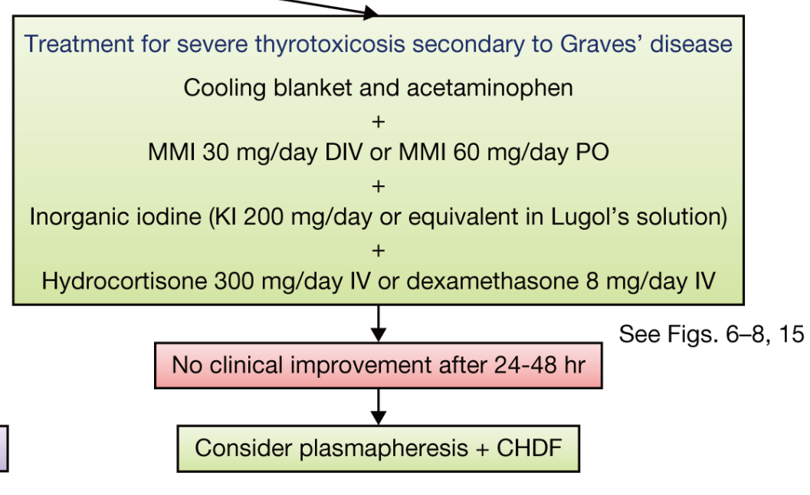
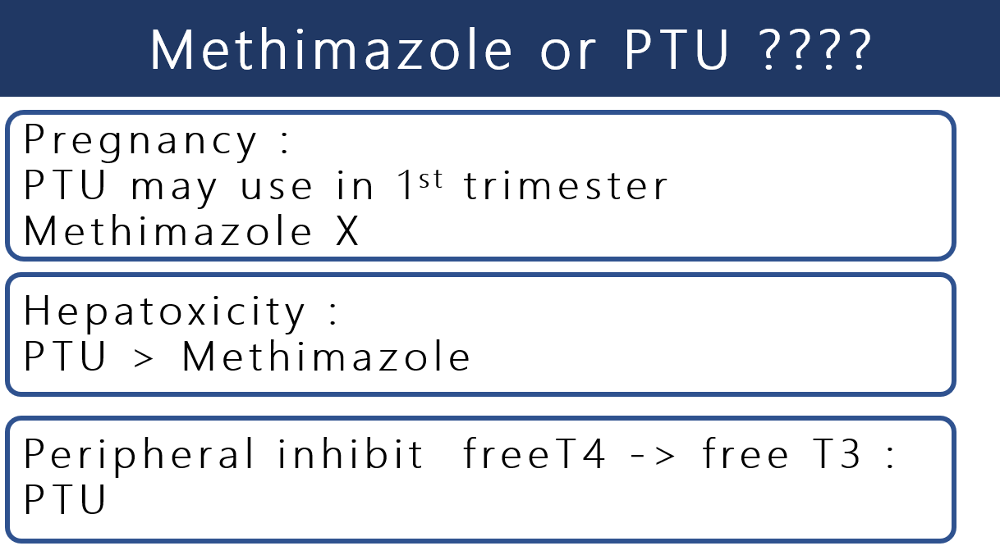
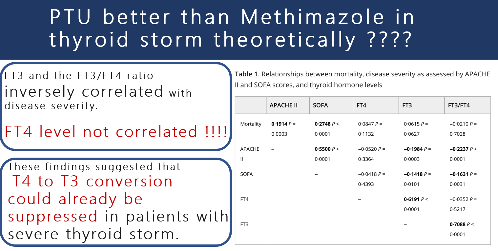
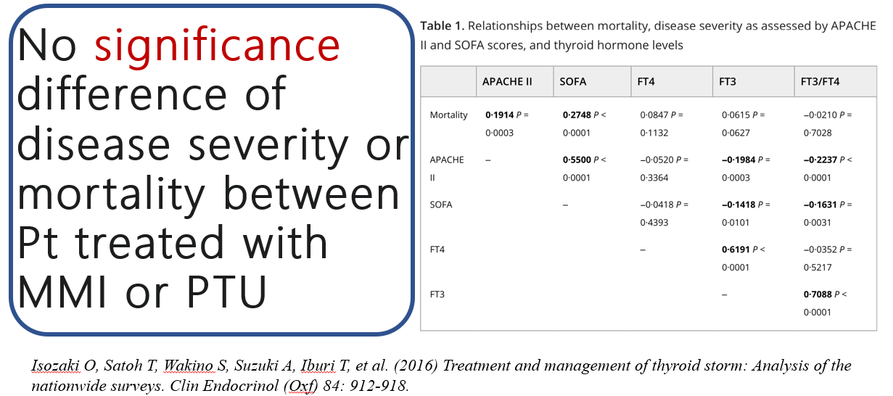
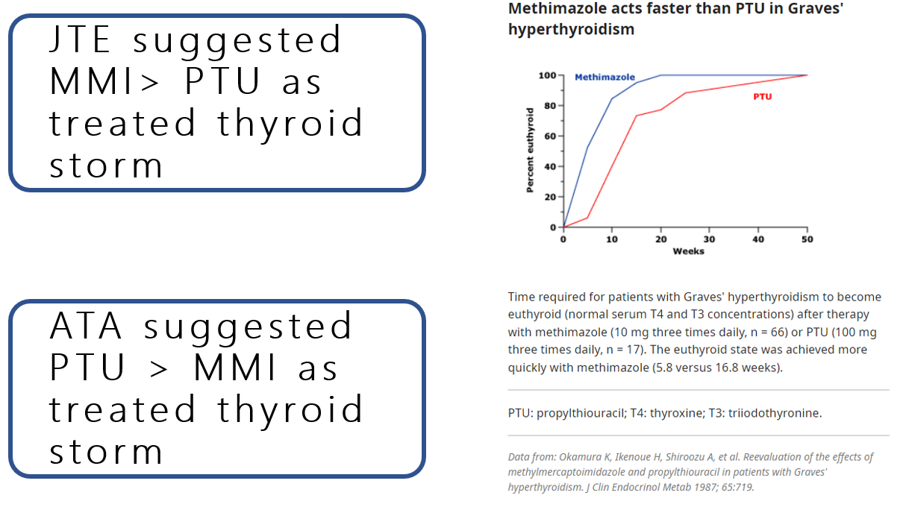
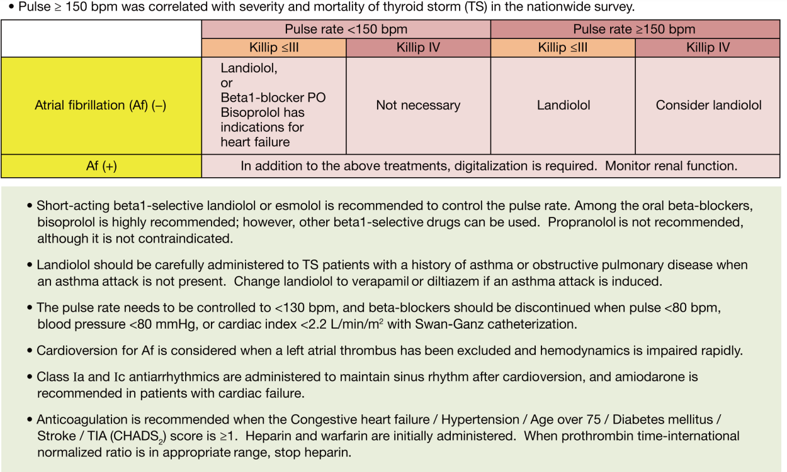
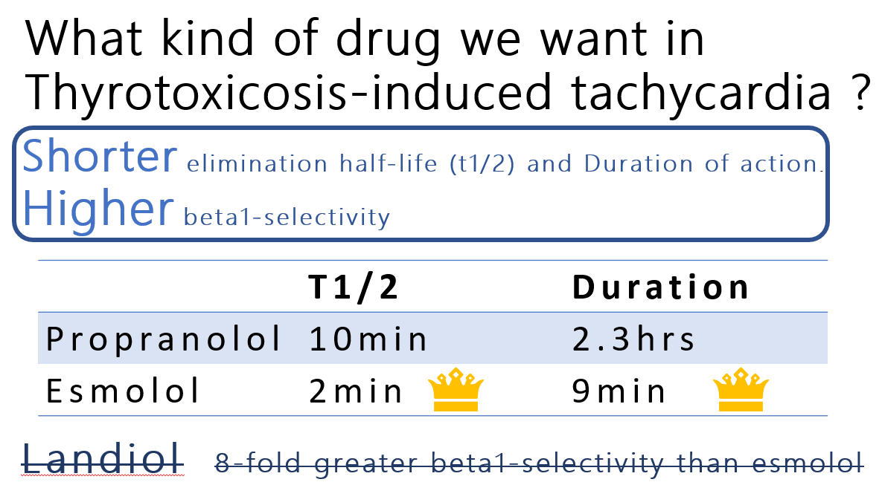
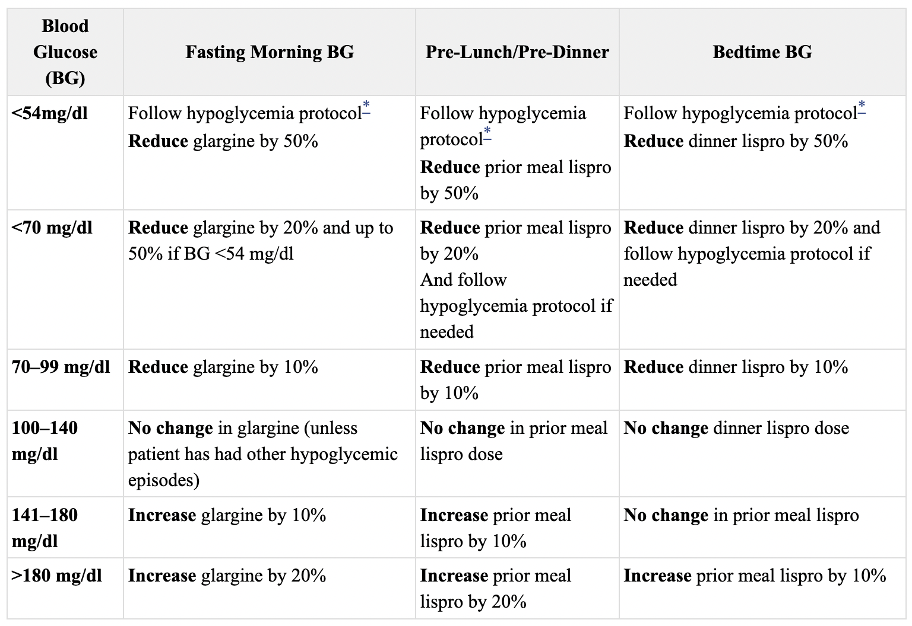

# Endocrine Emergencies

> 📖 **Tintinalli**：[Ch228 Hypothyroidism and Myxedema Crisis](https://drive.google.com/file/d/1DAFkFqHkrDRTsv113ps1Yq8fXeSUZdrR/view)｜[Ch229 Hyperthyroidism and Thyroid Storm](https://drive.google.com/file/d/1c4OLSru-jEBtiiHdVZdx5L4fhoH8VujX/view)｜[Ch230 Adrenal Insufficiency](https://drive.google.com/file/d/1-D9koyTbTnpvAs3ETDVvhycItYSlGx4u/view)｜[Ch165 › Pituitary Apoplexy](https://drive.google.com/file/d/1VNt9eRcf08-Tjnwu6oHZUA-JI_Lc2L7n/view)

> Source: Notion「Endocrine Emergencies」（Meta）；Heptabase「黏液性水腫(Myxedema)」「“住院”病人血糖控制的標準」。詳細投影片：endocrine_emergencies_NP.pptx（SharePoint 連結見原 Notion 頁）；林口長庚急診 OBN survival guide「[總是會 miss 掉但會死人的 Thyroid storm](https://lnkemergency.xms.tw/media/1313)」（需登入）

## Key Points
- 急症定義：會造成失能或死亡、病情快速進展、器官失能接近死亡
- 腦下垂體會致死的 pathway：**ACTH、TSH**

### 1. 腦下垂體中風（Pituitary apoplexy）
- 常見於已有 **macroadenoma** 的人
- 臨床表徵
  - **Secondary adrenal insufficiency（75%）** — 最常見死因
  - Secondary hypothyroidism（50%）
  - Hypogonadism
  - [Hyponatremia](../07_Nephro/低血鈉與SIADH.md)（40%）
  - DI
- 診斷：**MRI**
- 治療
  - **Hydrocortisone** 100–200 mg IV ST，之後 continuous infusion 2–4 mg/hr（或 50–100 mg IM Q6H）
  - 建議開刀：嚴重**視力**減退、嚴重**視野**缺損、**意識惡化**

### 2. Adrenal crisis 急性腎上腺不足
- 定義：**急性腎上腺不足＋器官失能**
- 高風險族群
  - 已知 AI
  - **長期類固醇**（prednisolone 5 mg >4 週）
  - 短期高劑量類固醇
  - **剛停類固醇**
- 臨床：**low grade fever**（glucocorticoid 有抗發炎作用，缺乏時會發燒）
- ⭐⭐ 線索：**不符合比例的嚴重 dehydration、hypotension、[shock](../04_Infection/Shock.md)**

### 3. Myxedema coma
- 定義：**嚴重甲低＋意識障礙＋器官失能**
- **長期甲低** ± 誘發因子（敗血症、寒冷、麻醉）
- 常見**老年女性**
- Mortality 30–50%（通常發現得晚）

- 黏液性水腫（Myxedema，Heptabase）：hypothyroidism 的表現；mucopolysaccharides 沉澱在 dermis，造成 interstitium 間 oncotic pressure 增加 → 組織間 fluid 很黏稠，阻止淋巴回流 ⇒ **non-pitting edema**！！→ 會導致腕隧道症候群

### 4. Thyroid storm
- 處置：抗甲狀腺藥物、高濃度碘、血漿置換（plasma exchange）

#### 什麼時候要想到 thyroid storm？（OBN）
- 參考：2016 Guidelines for the management of thyroid storm from the Japan Thyroid Association and Japan Endocrine Society（first edition）
- 有以下情形就順手驗 **TSH、free T3、free T4**：
  - 年輕人
  - 心跳快：sinus tachycardia、atrial fibrillation
  - 喘、手腳腫
  - 發燒（fever survey 有 finding 也不要總是只有 sepsis 這個診斷，有時候 infection 就是 systemic disease flare up 的 precipitating factor！）
- **Burch-Wartofsky Point Scale（BWPS）**列的意識不清、肝衰竭，常常是 severe thyroid storm 的表現
- 疑似 thyroid storm 要緊急檢測時，可聯繫檢驗科急做（約 2 小時發報告）

### 5. DKA／HHS
- 見 [DKA & HHS](DKA與HHS.md)

## Management
### Thyroid storm 治療（OBN）
- **BP 不好、bedside echo LVEF 差 ⇒ beta-blocker 禁用！！** 用了病人會很快 collapse

🖼️ 圖片轉錄（JTA：severe thyrotoxicosis secondary to Graves' disease）
- Cooling blanket + acetaminophen
- + MMI 30 mg/day IV 或 MMI 60 mg/day PO
- + Inorganic iodine（KI 200 mg/day 或等量的 Lugol's solution）
- + Hydrocortisone 300 mg/day IV 或 dexamethasone 8 mg/day IV
- 24–48 hr 沒有臨床改善 → 考慮 plasmapheresis + CHDF

**Tintinalli 的給藥順序**
1. **Supportive care**：記得驗血糖，太低要補
2. **抑制 adrenergic effect**（禁忌：decompensated heart failure）
   - Propranolol（抑制交感過度活化、抑制 T4 轉 T3）：PO 20–120 mg/dose 或 160–320 mg/day 分次；less toxic 病人 PO 60–80 mg Q4H
   - Esmolol：IV load 250–500 µg/kg，maintain 50–100 µg/kg/min
3. **抑制甲狀腺素合成（thionamide）**
   - **Methimazole**：half-life 較長；pregnancy category D（first trimester 禁用，second～third trimester 仍建議使用）；20 mg PO Q6H
   - **PTU**：500–1000 mg PO STAT，之後 250 mg Q4H；要注意 liver injury，FDA 建議留給不能用 methimazole 的人；好處是 block T4 → T3 conversion；第一孕期給 PTU；小兒不給 PTU
4. **抑制 thyroid hormone release**：**必須在 thionamide 給完 1 小時以上才能補碘**（利用高濃度碘抑制甲狀腺製造、釋放，Wolff-Chaikoff effect）
   - Lugol solution：8–10 drops PO initially，之後 Q6–8H
   - 替代：iodinated radiographic contrast、lithium（抑制甲狀腺釋放）
5. **避免周邊 T4 轉 T3**：這些病人同時可能有 relative adrenal insufficiency
   - Hydrocortisone 300 mg IV STAT，之後 100 mg Q8H
   - Dexamethasone 2 mg Q6H
6. **避免甲狀腺素再吸收、加強排出**：甲狀腺素在肝臟代謝排到膽汁，有腸肝循環
   - Cholestyramine 4 g Q6H
   - Plasmapheresis、charcoal hemoperfusion、resin hemoperfusion、plasma exchange 也可移除甲狀腺素
7. **解決其他加重因子**：MI、DKA、PE 等

## Medications
- **Adrenal crisis**
  - **Hydrocortisone 100 mg IV ST，然後 100 mg IV Q6H**（急症都用 hydrocortisone）
  - **N/S 2–3 L** rehydration
- **Pituitary apoplexy**：Hydrocortisone 100–200 mg IV ST → 2–4 mg/hr（或 50–100 mg IM Q6H）

### Thyroid storm：antithyroid drug 怎麼選？（OBN）

🖼️ 圖片轉錄
- Pregnancy：1st trimester 可用 PTU，Methimazole 不行
- Hepatotoxicity：PTU > Methimazole
- 周邊抑制 free T4 → free T3：PTU

- 過往習慣 thyroid storm 選 PTU，因為理論上可以抑制 free T4 轉為 free T3
- 但日本（JTA）研究發現：**thyroid storm 越嚴重，free T3 和 FT3/FT4 反而越低，free T4 則無關** ⇒ 推測太嚴重時已經有負回饋抑制 T4 → T3 轉換

  

  

  🖼️ 圖片轉錄：MMI 或 PTU 治療的病人，疾病嚴重度或死亡率沒有顯著差異（Isozaki O, et al. Clin Endocrinol (Oxf) 2016;84:912-918）
- 加上後續 hyperthyroidism，**Methimazole 比 PTU 更快**讓甲狀腺素回到正常濃度
  - 🖼️ 圖片轉錄：Graves' hyperthyroidism 用 methimazole（10 mg TID）比 PTU（100 mg TID）更快 euthyroid（5.8 vs 16.8 週）
- 結論：**JTA 建議 MMI > PTU；ATA 目前仍建議 PTU > MMI** ⇒ 其實都可以考慮，同時會診 Meta 詢問意見

  

### Thyroid storm：心跳控制（OBN）
- 心跳 >150、血壓 ok，還是要控制心跳
- **Propranolol 是下下策**；可以考慮 **Esmolol**（自費）；Landiolol 是好藥

🖼️ 圖片轉錄（JTA：pulse ≥150 bpm 與嚴重度、死亡率相關）
| | Pulse <150, Killip ≤III | Pulse <150, Killip IV | Pulse ≥150, Killip ≤III | Pulse ≥150, Killip IV |
|---|---|---|---|---|
| Af (−) | Landiolol 或 β1-blocker PO（bisoprolol 有心衰竭適應症） | 不需要 | Landiolol | 考慮 landiolol |
| Af (+) | 上述治療之外，需要 digitalization，監測腎功能 | | | |

- 建議用短效 β1-selective 的 landiolol 或 esmolol 控制心跳；口服首推 bisoprolol，其他 β1-selective 也可；**propranolol 不建議，但不是禁忌**
- 有氣喘或 COPD 病史（目前沒發作）小心使用 landiolol；誘發氣喘就改 verapamil 或 diltiazem
- 心跳控制到 **<130 bpm**；pulse <80、BP <80 mmHg 或 cardiac index <2.2 時停 beta-blocker
- Af：排除左心房血栓且血行動力快速惡化時考慮 cardioversion；之後用 class Ia、Ic 維持竇性心律，心衰竭病人用 amiodarone
- CHADS₂ ≥1 建議抗凝：先 heparin + warfarin，INR 到範圍再停 heparin

🖼️ 圖片轉錄
- 理想：**半衰期和作用時間短、β1 選擇性高**
- Propranolol：T1/2 10 min、duration 2.3 hrs；**Esmolol：T1/2 2 min、duration 9 min**
- Landiolol：β1 選擇性比 esmolol 高 8 倍
- ⚠️ 原文如此，待查證：Propranolol T1/2 10 min
- **Esmolol 劑量**（🖼️ 圖片轉錄）：500 mcg/kg IV ×1（＝ 3 × 體重 / 60，run 1 min），then 50 mcg/kg/min IV × 4 min（＝ 0.3 × 體重 mL/hr，以 100 mg/10 mL 計算）

### 住院病人血糖控制的標準（Heptabase）
- Guideline：<https://www.ncbi.nlm.nih.gov/books/NBK559540/>
- 控制目標：飯前 **100–140**，隨機 **<180**
- 胰島素起始劑量 → **0.5 U/kg/day**，再平分一半給 basal，一半給 bolus
- Insulin 的調整（圖片，未轉錄）

  

## Disposition
（待補）

## Clinical Pearls
- 有類固醇使用史＋不成比例的[脫水](../07_Nephro/脫水.md)／低血壓／休克 → 想 adrenal crisis
- 急症的病人都用 hydrocortisone
- Thyroid storm 合併血壓差或 LVEF 差：beta-blocker 禁用；Lugol 要在 thionamide 後 1 小時以上（OBN）
