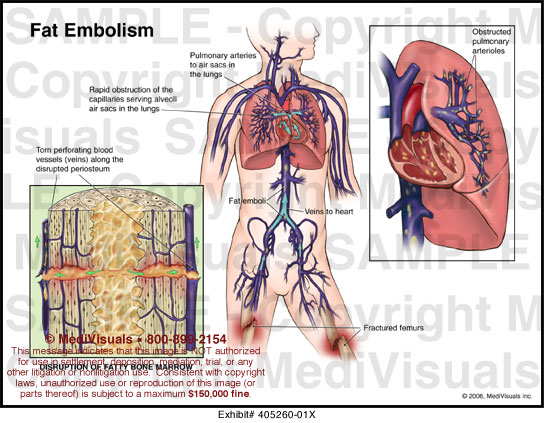
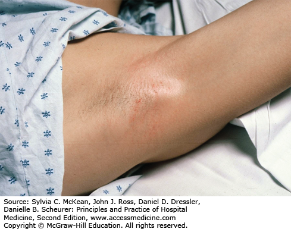

# Fat Embolism Syndrome (FES)

> Source: Notion「Fat Embolism Syndrome」（含報告段落）
> 參考：Madisi & Oropello, Postoperative Management After Specialty Surgery；Drew et al., Management of Common Perioperative Complications in Orthopedic Surgery

## Key Points
> 💡 **Long bone fracture！**

### 病因
- **Trauma-related**：**長骨骨折（femur、tibia、pelvis）**、骨科手術（下肢，THR/TKR 無症狀 fat embolism 約 46–65%）；soft tissue injury、[燒燙傷](燒燙傷.md)、crush injury
- **Non-trauma**：pancreatitis、DM
- 流行病學：10–40 歲，男性較多；外傷病人 1–3.5%，雙側股骨骨折 4.8–7.5%，髓內釘固定可達 11%

### 病生理
- **機械性**：骨髓或脂肪組織的脂肪進入撕裂的靜脈 → 肺血管床（RV failure）＋全身發炎 → 影響腦、皮膚、呼吸、視網膜
- **生化**：free fatty acid、cytokines、CRP

### 臨床表現
- 通常受傷後 **24–72 小時**出現
- 順序：**肺部症狀最先** → 神經症狀同時或稍後 → **皮膚最後**
- **Clinical triad**：
  1. **Hypoxemia**
  2. **Neurologic dysfunction**（agitated 或 hypoactive delirium）
  3. **Petechial rash**（約 50%）：頭、結膜、口腔黏膜、頸、**腋下**、上 1/3 胸廓；只在身體前側非下垂處（背部沒有）

     

- 嚴重時：DIC、RV dysfunction、biventricular failure、ARDS、[shock](../04_休克與感染/Shock.md)、死亡

### 診斷（Gurd's criteria：2 大，或 1 大＋4 小）
| Major | Minor |
|---|---|
| 腋下或結膜下 petechiae | Tachycardia >110 |
| Hypoxemia（PaO2 <60，FiO2 0.4） | Fever >38.5°C |
| 與缺氧不成比例的 CNS depression（非[頭部外傷](頭部外傷.md)） | 眼底視網膜栓子 |
| [Pulmonary edema](../02_CV/Pulmonary_edema.md) | 尿中脂肪、Hct 或血小板突降、ESR 上升、痰中脂肪球 |

> 註：原筆記另一段 minor 還列了 jaundice、renal signs、anemia、thrombocytopenia、fat macroglobulinemia。原表格寫「Tachycardia <110」「Pyrexia <38.5」，方向應為 >，已更正。

- 沒有 specific diagnostic test
- Lab（非特異）：thrombocytopenia、anemia、leukocytosis、尿／痰／血中脂肪球、發炎指數上升

## Management
- 通常**自限性**、預後好 → **Supportive**
  - Hypoxemia → O2
  - Albumin（hypovolemia）
  - [插管](../01_急診流程與處置/插管與氣道.md)（[GCS](../01_急診流程與處置/GCS.md) <8）
  - 控制 ICP
- **類固醇**（抑制補體聚集、降低 FFA、穩定細胞膜；經驗性高劑量用於減輕肺部反應）
- IVC filter

### 預防
- ⭐⭐ **Early ORIF of long bone fractures**（highly recommended）— **可以預防，不能治療**
- Early immobilization of fractures
- 限制骨內壓
- Prophylactic corticosteroids

## Medications
（待補）

## Disposition
（待補）

## Clinical Pearls
- 長骨骨折後 1–3 天出現喘＋意識改變＋腋下瘀點 → 想 FES
