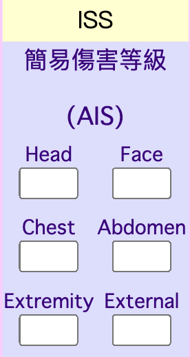
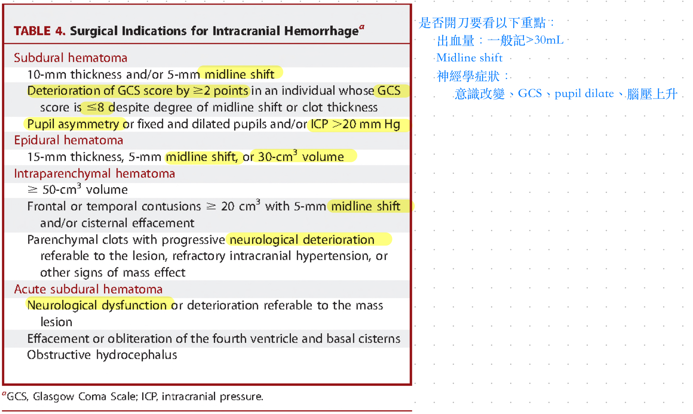
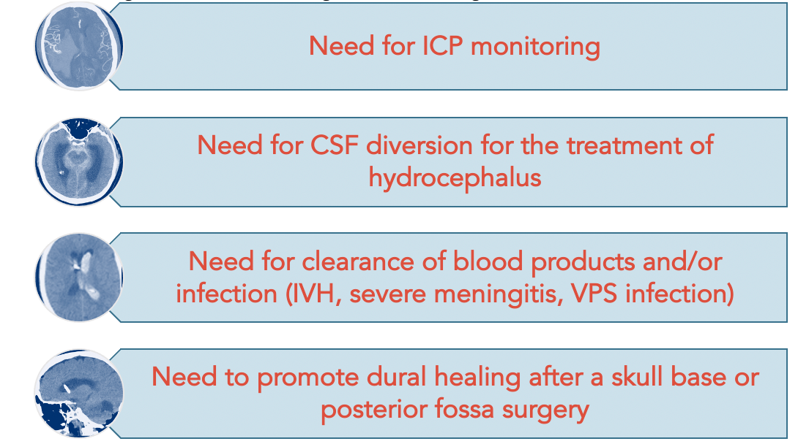
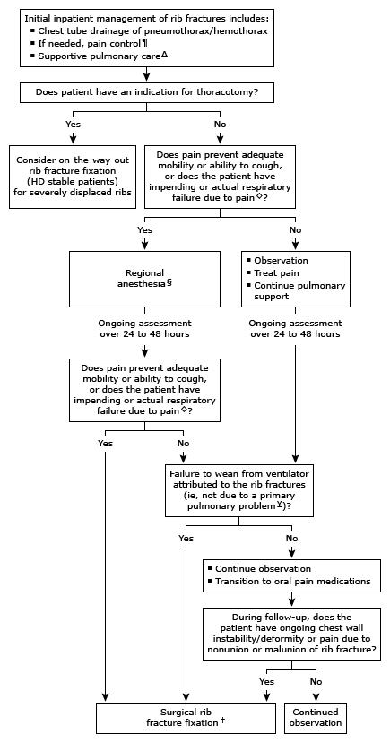
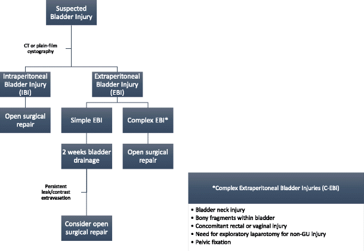
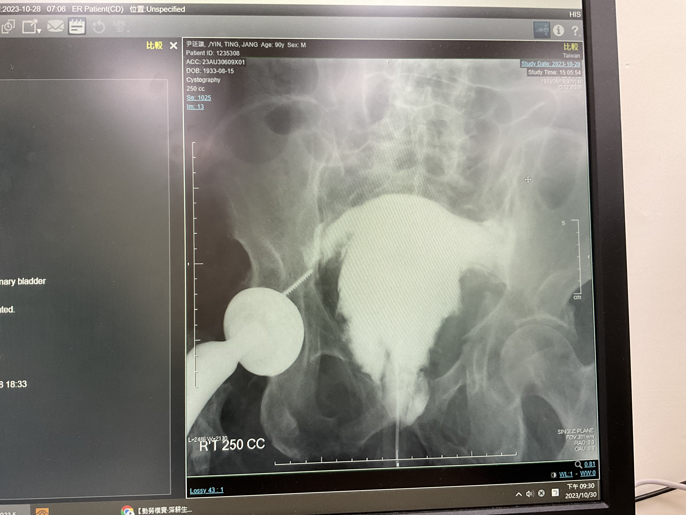
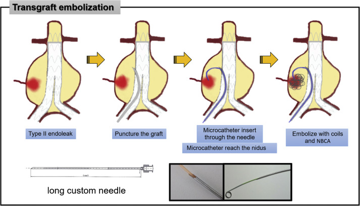
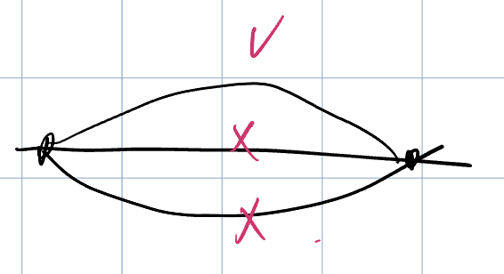
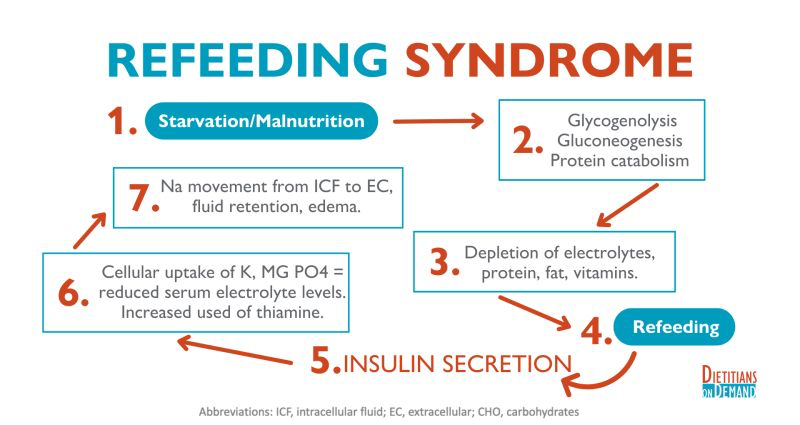

# Trauma Overview

> 📖 **Tintinalli**：[Ch254 Trauma in Adults](https://drive.google.com/file/d/1ac7ZJ_bXYvHnWGHaEP5j5S_HlJviPq-N/view)｜[Ch261 Pulmonary Trauma](https://drive.google.com/file/d/1u1I0OdHCRACU8CWsrDO2QCuTXvMmyYxO/view)

> Source: Notion「Trauma」總頁（2023/10 外傷科實習問題）＋「SICU」（CRASH-3）；Heptabase「Flail Chest」「Rib Fracture」「評估C-spine (when可以拿掉頸圈？)」「ASIA impairment score」「Myelopathy VS Radiculopathy」
> 子題另見：[Fat_Embolism_Syndrome](Fat_Embolism_Syndrome.md)、[TIC外傷性凝血病變](TIC外傷性凝血病變.md)、[IAH](../05_GI%20&%20GU/IAH與Abdominal_compartment_syndrome.md)、[Aortic_Dissection](../02_CV/Aortic_Dissection.md)、[頭部外傷](頭部外傷.md)、[脫臼](脫臼.md)、[Primary Survey (ABCDE)](../01_急診流程與處置/初級評估ABCDE.md)、[POCUS](../01_急診流程與處置/POCUS.md)（E-FAST）、[血行動力學](../01_急診流程與處置/血行動力學與重症.md)

## Key Points
### Lactate 的意義
- [Shock](../04_休克與感染/Shock.md)：組織灌流不足缺氧 → 無氧呼吸（pyruvate → lactate + 2 ATP）→ 乳酸堆積 → metabolic acidosis

### Trauma triad of death

  

- 身體很酸（pH 低）會讓血管無法收縮 ⇒ 低血壓 ⇒ shock

### ISS（Injury Severity Score）
- <9 輕度；9–15 中度；**>16 嚴重外傷**（死亡率 10%、可申請重大傷病卡）
- 身體分 6 區（頭、臉、胸、腹、四肢含骨盆、體表），每區取 AIS 最高者，**最嚴重 3 區的 AIS 平方加總**
- AIS 0–5 分

  

### 腹部外傷
- 腹腔內最常受傷的 solid organ：**liver、spleen、kidney**（Trauma abdominal CT 先看這三個）
- Trauma 造成 bowel perforation 的機會不高
  - 小孩：主要是外傷，1–7%
  - 大人：最多是潰瘍（duodenal ulcer 穿孔率為 gastric 的 2–3 倍），其次 diverticular disease（15%）
  - 老人：perforated appendicitis
  - Blunt injury 胃穿孔 0.02–1.7%；**penetrating 較容易穿孔**
- Traumatic Whipple 很少見（十二指腸、胰臟在後腹腔），最常在 pancreatic neck（直接壓到脊椎）

### Traumatic coronary artery dissection
- 很少見；**LAD（76%）> RCA（12%）> LCx（6%）**
- 機轉：心臟解剖位置（LAD 最易受傷）、RCA 起始處加減速傷、肋骨骨折撕裂、craniocaudal deceleration 剪力、compression-Valsalva injury

## Management
### Damage-control surgery（DCS）
- **先救命（keep patient alive），不先矯正解剖**；重建之後再計畫
- 目標：控制出血、控制污染、防止 hypothermia、temporary abdominal closure、angiography/embolization
- **Absolute indications**（矯正 trauma triad）
  1. Base deficit >8 mEq/L 或惡化
  2. **pH <7.2**
  3. **SBP <90**
  4. **Hypothermia <34°C**
  5. PTT >60 秒
  6. 術中臨床 coagulopathy

### Traumatic spinal cord injury
- **評估 C-spine（when 可以拿掉頸圈？）**（Heptabase）
  - 只要有任何懷疑 **spine injury** ⇒ 就去**切 CT！！**
  - 外傷區的通常都是整個某一截 spine 以下都不能動
  - 會有半邊的通常都不是外傷的問題
  - 有 SDH 可能就會 coma 了
- **ASIA impairment scale**（Heptabase 圖片轉錄）
  | | | |
  |---|---|---|
  | A | Complete | No motor, no sensory, no sacral sparing |
  | B | Incomplete | No motor, sensory only |
  | C | Incomplete | 50% of muscles LESS than grade 3（can't raise arms or legs off bed） |
  | D | Incomplete | 50% of muscles MORE than grade 3（can raise arms or legs off bed） |
  | E | Normal | Motor and sensory function are normal |
- Myelopathy 有時候會伴隨 radiculopathy（Heptabase）
- 內科：vital sign、心律、氧合、neurologic sign；注意低血壓、[呼吸衰竭](../03_呼吸與酸鹼/呼吸衰竭.md)、[DVT](../02_CV/DVT與抗凝血藥物.md)
  - Glucocorticoids：methylprednisolone（原筆記：實證可改善 neurologic outcome）
- 外科：decompression & stabilization
  - Closed reduction：cervical spine fracture with subluxation 可以，**胸腰椎不行**
  - Cervical 手術 indication：顯著 cord compression 合併 neurologic deficit；unstable fracture 或 dislocation

### 頭部外傷
- **腦壓高**：頭抬高 30°、頭擺正（不然會壓到 vein）
- **ICP monitoring indication**
  1. 嚴重頭部外傷（[GCS](../01_急診流程與處置/GCS.md) 3–8）且 CT 異常（hematoma、contusion、edema、compressed basal cisterns）
  2. 嚴重頭部外傷（GCS 3–8）CT 正常，但符合以下 ≥2 項：年齡 ≥40、單側或雙側 motor posturing（去大腦、去皮質、偏癱）、SBP ≤90
  3. 輕度（GCS 13–15）、中度（9–12）不建議常規監測
- 腦出血何時開刀

  

- EVD indication

  

- **TTM（目標體溫管理）**
  - 最早用在 cardiac arrest：32–34°C 維持 24 hr，降低腦部電活動與自由基傷害
  - TBI：可降低 ICP、減少組織腫脹（[IICP](../06_神經/頭痛與顱內壓/IICP.md) → 壓迫腦血管 → 灌流不足 → brain necrosis）
  - 方法：體內循環降溫、體外貼片
  - 併發症：**最主要心律不整**；利尿 → 電解質失衡；胰島素敏感度下降 → 血糖上升
- **CRASH-3（TXA in TBI）**：瞳孔有反應及／或 mild–moderate GCS 的病人較能從 TXA 受益（基礎顱內出血較少）；**延遲給藥效果下降**
- V-P shunt（水腦症內引流）：放在**皮下**

### 胸部外傷
**Flail chest**（Heptabase）
- 定義：連續 3 根肋骨有 2 處以上骨折
- 臨床表現：胸壁相悖起伏（**paradoxical motion**）→ 吸氣時內縮，呼氣時外擴
- Management
  1. 體液補充
  2. **止痛（很重要！）**：nerve block、epidural、肋間固定帶
  3. [插管](../01_急診流程與處置/插管與氣道.md) + 呼吸器
  4. ORIF：很少需要手術！
  - ⚠️ 原文如此，待查證：Heptabase 版寫「ORIF 很少需要手術」，Notion 版寫 flail chest ⇒ early surgery

**Rib fracture**
- Heptabase：什麼時候要開刀？1. Flail chest　2. >4 根肋骨 displaced（骨頭完全沒連在一起）
- 長庚肋骨 team routine（Heptabase）：1. [CXR](../03_呼吸與酸鹼/Chest_X-Ray判讀.md) QD ×3　2. 止痛 by clock　3. 化痰（因為咳痰能力不好）　4. 吸 Triflo（肺擴張、把血擠出去）
- 初始住院：thoracostomy tube 引流、fluid management、DVT prophylaxis
- 止痛（mobility 或咳痰能力不足時）：acetaminophen、NSAID、**區域麻醉**；注意呼吸抑制
- Supportive：incentive spirometry（防插管）
- Flail chest 更容易插管、上呼吸器 ⇒ **early surgery**
- 手術建議固定 **4–9 肋**（1–2 釘不到且有 scapula 擋、11–12 浮肋，對呼吸貢獻小）
- 手術適應症：呼吸衰竭或 flail chest、嚴重胸壁變形、無法脫離呼吸器（非 contusion 造成）、因其他原因開胸時順便固定（on-the-way-out fixation）、nonunion/malunion 持續疼痛
- **ICU indication**：>5 根肋骨骨折、multiple displaced、flail chest；tachypnea、SpO2 <92%

  

**Hemothorax 手術適應症（urgent thoracotomy）**
- [Chest tube](../01_急診流程與處置/管路與Procedure.md) 24 小時引流 **1500 ml**
- 置管後 **300–500 ml/hr 連續 2–4 小時**
- 大血管或胸壁損傷
- Pericardial tamponade

### 骨盆與泌尿
- **Pelvic fracture**：pelvic ring **unstable** 要開刀（LC type 2–3、APC type 2–3、VS）；**SBP <80 要[輸血](../09_Hema%20&%20Oncology/輸血.md)**
- **Bladder rupture 開刀**：intraperitoneal bladder injury；EBI 合併 bladder neck injury、膀胱內有骨碎片、直腸或陰道損傷、因非 GU 傷需開腹、需 pelvic fixation

  
  

### 血管
- **TEVAR complication**：spinal cord ischemia、[stroke](../06_神經/01_中風/中風Stroke.md)、**endoleak**（用 coil embolization 預防 type 2）、endograft collapse（少）、cardiopulmonary、AKI

  

- **AAA 手術 indication**：男 >5.5 cm（女可從 5.0 cm 考慮）、有症狀、快速擴大 >1 cm/年

## Medications
（待補）

## Disposition
（待補）

## Clinical Pearls
### 外傷科實習雜記

- 會影響**心臟**的電解質：**K、Ca、Mg**
- **CRP 代表 inflammation 不是 infection**（開刀、癌症壞死都會高）；CRP 看量級，**procalcitonin 看趨勢**（>10 就很高）
- CRP 等追蹤要**抽三次**才有意義，先升後降才是好的

  

- **AST/ALT 上升**：shock liver（灌流不足）或 congestion（HF 造成 IVC 回流不良）；**ALT 較 liver specific**，AST 骨頭也有
- **Drug [fever](../04_休克與感染/發燒Fever.md)**：不會 chillness，出現在給藥後，lab data 很漂亮
- 會 AKI 和會 [seizure](../06_神經/02_意識與癲癇/癲癇%20Seizure.md) 的[抗生素](../04_休克與感染/抗生素.md)不要一起用（腎功能變差後就開始 seizure）
- Albumin：讓血管內 volume 上升
- NPO 太久 → **cholestasis**，bilirubin 上升（沒油脂 → CCK 不分泌 → 膽囊不收縮）
- 拔管前盡量脫水到「淨體重」；太多水易失敗，太乾不一定比較好
- 代謝廢物太多（BUN 很高）= 有機酸（原筆記寫 non-anion gap acidosis，⚠️ 有機酸堆積通常是 **high** anion gap，請確認）
- **Hb <5–6**：升壓劑怎麼用都升不上去，必須輸血
- Refeeding syndrome

  
