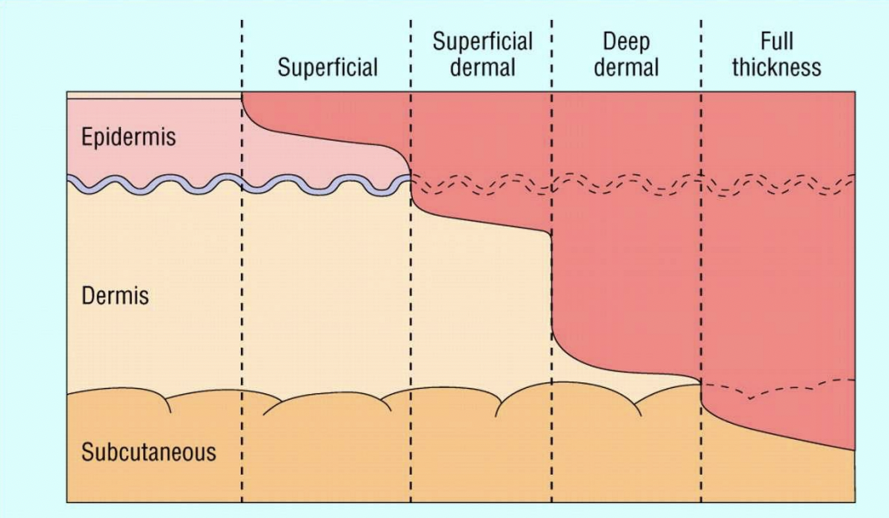

# Burns

> Source: Notion「燒燙傷」（整形外科）。燙傷藥膏見 [急診常用藥物](../01_急診流程與處置/急診常用藥物.md)（silver sulfadiazine）。

## Key Points
### Burn depth

| 深度 | 定義 | 症狀 |
|---|---|---|
| 1st degree | 只到表皮 | 紅腫熱痛，**沒有水泡**；會有 pigmentation |
| Superficial 2nd（淺二度） | 到一點點真皮 | 紅、痛、**有水泡** |
| Deep 2nd（深二度） | 大面積真皮 | 出現 **eschar** |
| 3rd degree | 皮膚全層，毛囊汗腺不會再長 | |
| 4th degree | 通常是電傷，到肌肉、fascia、骨頭、肌腱 | |

- 只要出現**白色的 eschar（焦痂）**就是**深二度以上**

## Management
（待補）

## Medications
（待補）

## Disposition
（待補）

## Clinical Pearls
- 燒燙傷 >48 hr 禁用 succinylcholine（高血鉀，見 R1 Checklist）
- 燒燙傷也是 fat embolism 的原因之一
