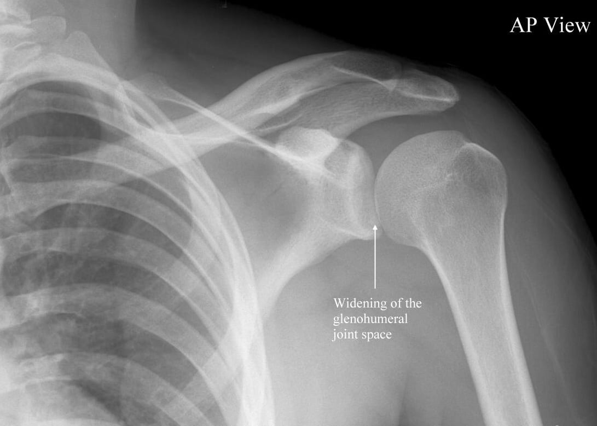
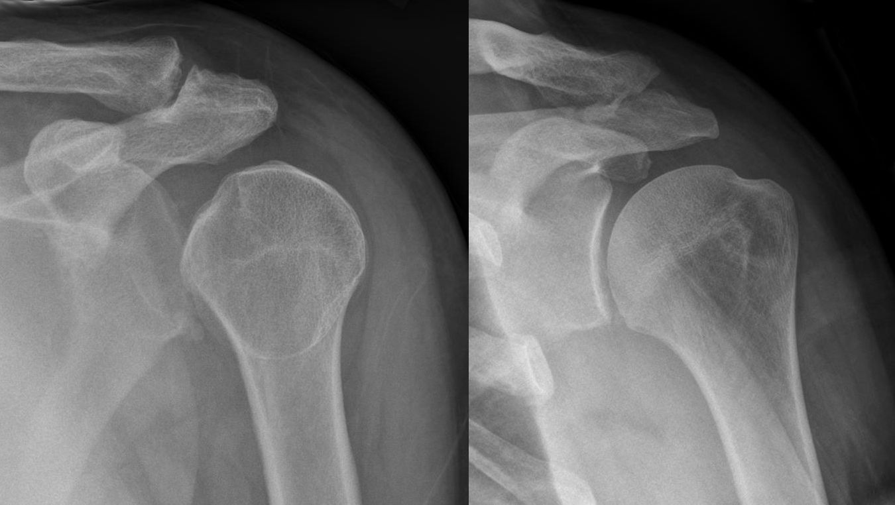
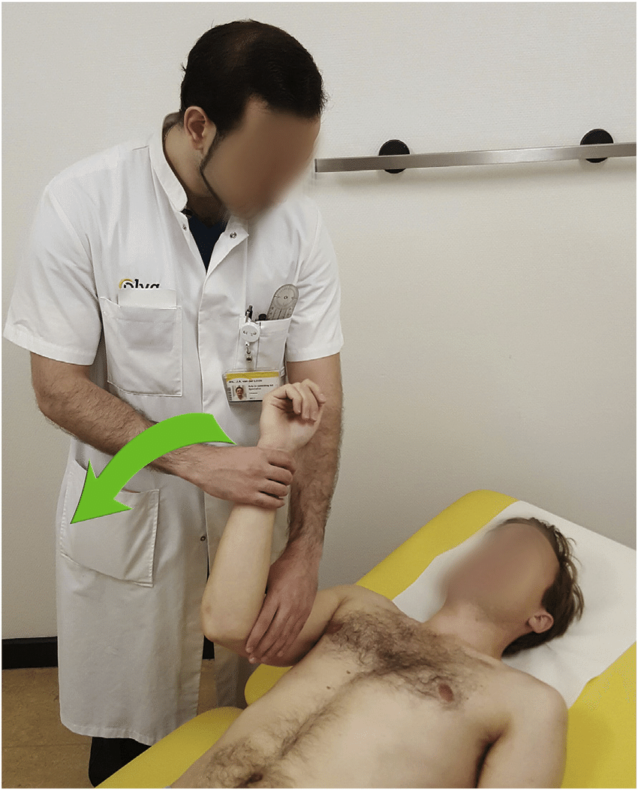
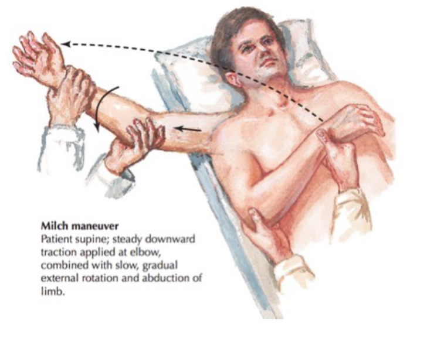

# Dislocations

> 📖 **Tintinalli**：[Ch271 › Glenohumeral Joint Dislocation](https://drive.google.com/file/d/1SY5Lurv-NZ3ePmBdokJnJdp6mp-jNZEC/view)｜[Ch274 › Knee Dislocation](https://drive.google.com/file/d/1hDFB7FV3xwFIWJ1CcSgs7wCzpuukRbsC/view)｜[Ch243 › Mandible Dislocation](https://drive.google.com/file/d/1Gjl1lLeEv6_67RLkH20P9Ezv5BADKBYo/view)

> Source: Heptabase「急診」白板（Pitfalls of shoulder dislocation、TMJ dislocation、膝蓋的脫臼更難處理）

## Key Points

### Shoulder dislocation
- 大部分 95% 是**往前**脫位（**anterior** dislocation）⇒ abducted、externally rotated
- 可能會傷到 brachial plexus，所以可以測試一下 median、ulnar、radial 的 function
- **Posterior dislocation**
  - Risk factor（conscious 不好）：[seizure](../06_神經/02_意識與癲癇/癲癇%20Seizure.md)、被電到
  - X-ray 的異常不容易看

    
    1. **Widening of glenohumeral joint space**（>6 mm）
    2. **Lightbulb sign**：因為 humerus 有 **internal rotation**

    

### Knee
- 膝蓋的脫臼更難處理

## Management

### Shoulder：復位的手法（前脫位）
- 脫臼要早點復位，不然會 stiffness
- Procedure sedation：在急診的麻醉風險
- **首選：external rotation maneuver**（坐著就可以做）

  
- 如果 external rotation 不行 ⇒ 再接著做 **Milch**
  - 但是 Milch 不會單獨做

  
- Scapular manipulation

### TMJ dislocation
- UpToDate 推薦順序：Syringe > Intraoral > Extraoral
  1. Syringe technique
  2. Intraoral technique（向下 → 向後）
  3. Extraoral（很痛、成功率不高）

## Medications
（待補）

## Disposition
（待補）

## Clinical Pearls
（待補）
