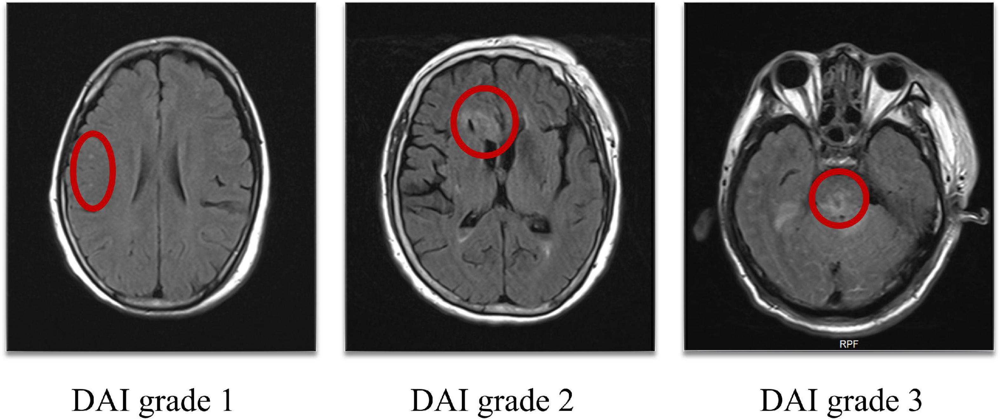
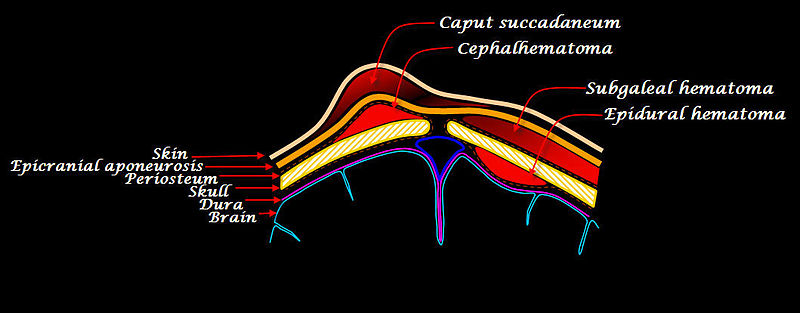

# Head Trauma

> 📖 **Tintinalli**：[Ch257 Head Trauma](https://drive.google.com/file/d/1tuoA-X0-J_u8NK3dlwaUai0xPfav4RPZ/view)

> Source: Heptabase「Brain trauma」「Traumatic ICH」「Acute SDH」「SDH影像」「EDH」「EDH影像」「SAH影像」「Diffuse axonal injury (DAI)」「Skull base fracture」「Scalp hematoma」「什麼時候要做Brain-CT?」「為什麼trauma要評估Pupil size?」
> Related: [Trauma總論](Trauma總論.md)（頭部外傷：ICP monitoring、CRASH-3、TTM）、[IICP](../06_神經/頭痛與顱內壓/IICP.md)、[中風Stroke](../06_神經/01_中風/中風Stroke.md)（Hemorrhagic stroke CT、ICH 原因表）

## Key Points

### 什麼時候要做 Brain CT？
- Loss of consciousness
- Focal neurological sign
- **Skull or skull base fracture**
- Multiple trauma：很多地方受傷
- Memory loss
- [Seizure](../06_神經/02_意識與癲癇/癲癇%20Seizure.md)
- Headache
- Vomiting
- Alcohol
- Age <2 y/o

### 為什麼 trauma 要評估 pupil size？
- 因為要看看有沒有 uncal herniation

### Traumatic ICH
- 常見位置
  - **Frontal & anterior temporal lobes**：常見有 coup and contrecoup（腦袋晃到另一邊）
  - Basal ganglia and thalamus

### EDH
- 大部分是因為 **arterial bleeding**！很常出現在 trauma 裡面
- 盡快處理的話，預後比較好
- 通常會跟 **skull fracture** 一起發生
- S/S：lucid interval
- 影像：不會過 suture line；常出現在年輕人

### SDH
- Acute SDH 跟 EDH 相比：更高的撞擊力道
- 影像：可以跑到 **falx** or **tentorium**
- 常常出現在**老人家跌倒**，不用傷很大；臨床上較多

### SAH 影像
- Focal
- **Diffuse ⇒ 一定要馬上想到 aneurysm**（如果不是 trauma）
  - 五角大廈：basal system

### Diffuse axonal injury（DAI）
- 機轉
  - 最常在 high-speed motor vehicle accidents 看到
  - The most common mechanism：頭部強烈的搖晃＆旋轉導致 **accelerating and decelerating motion that leads to shearing forces to the white matter tracts of the brain**
- Grading（死後解剖）

  
  - Grade 1：**只有 microscopically 的 axonal damage** — evidence of axonal damage in the white matter of the cerebral hemispheres including the corpus callosum, in the brain stem and, occasionally, in the cerebellum: this damage can only be identified microscopically.
  - Grade 2：**胼胝體有 focal lesion** — focal lesion in the corpus callosum in addition to diffuse axonal damage: the focal lesion was identifiable only microscopically. Can be said to be severe if the focal lesions are apparent macroscopically.
  - Grade 3：**胼胝體和 dorsolateral quadrant of the rostral brain stem 都有 focal lesion** — the focal lesion was identifiable only microscopically. Can be said to be severe if the focal lesions are apparent macroscopically.
- 臨床診斷（上面都是死後解剖，所以臨床上都是用症狀＆影像學來診斷的）
  - CT：可能會看到 small punctate hemorrhages to white matter，但是一般來說 CT 很難來診斷
  - MRI：DTI、GRD
  - 經過 surgical evacuation of subdural or epidural hematomas 後意識依然沒有顯著改善 ⇒ 懷疑有 DAI

### Scalp hematoma

- **Subgaleal hemorrhage**：介於 aponeurosis 和 periosteum 中間 ⇒ **跨 suture**；成因：vacuum；在小孩比較危險，進展很快
- **Cephalohematoma**：被 periosteum 包住 ⇒ 不會跨 suture；成因：vacuum
- **Caput succedaneum**：**可跨 suture**

## Management
- Severe 的應該趕快去開刀！
- **Acute SDH**：**不要降腦壓！不要用 Mannitol！！**（因為降腦壓藥的作用是降低 brain parenchyma 的體積）；手術目的：減壓 ＋ 找出血點
- **Skull base fracture**：不要 on NG！可以用 OG（從嘴巴放）、內視鏡；放著會自己好

## Medications
- Mild to moderate TBI：**Transamin**
  - Loading dose：前 10 分鐘 1 g
  - 之後 8 hr 也是 1 g

## Disposition
（待補）

## Clinical Pearls
（待補）
