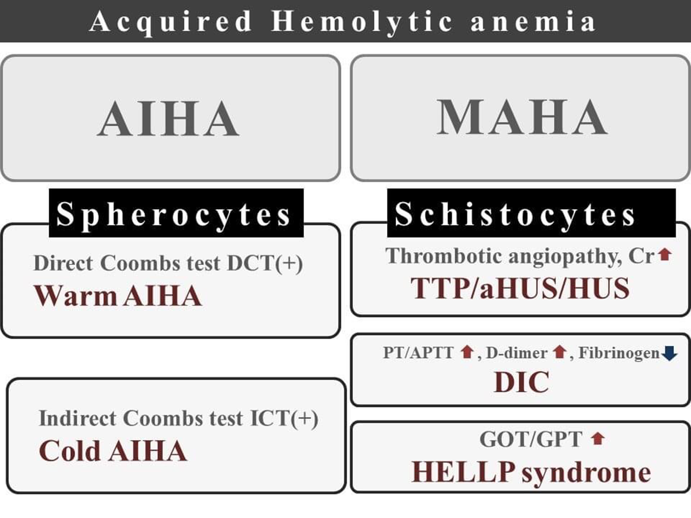
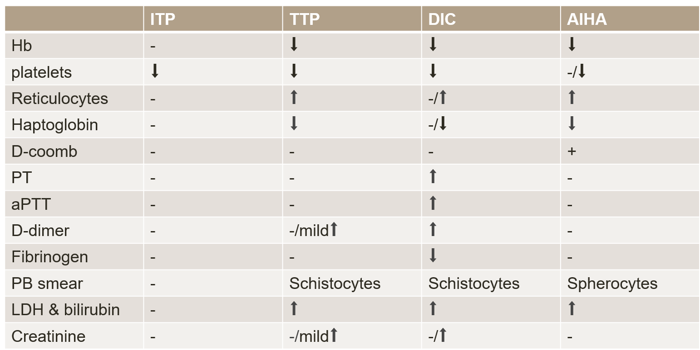
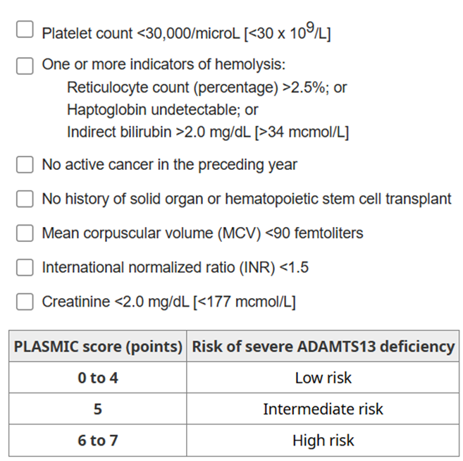

# Hemolytic Anemia & TTP

> Source: 林口長庚急診 OBN survival guide「Hemolytic anemia 的鑑別診斷，與何時要想到 TTP」（[原文](https://lnkemergency.xms.tw/p/anemia)，需登入）
> Related: [輸血](輸血.md)、[化療與免疫療法血液副作用](化療與免疫療法血液副作用.md)、[TIC外傷性凝血病變](../08_外傷與外科/TIC外傷性凝血病變.md)

## 貧血 work-up 怎麼驗
- **CBC/DC**
- **排除 DIC**：PT、aPTT、D-dimer、FDP、Fibrinogen（很嚴重的 DIC 才會看到 fibrinogen 下降，表示 outcome 不佳）
- **懷疑溶血**
  - Direct/indirect bilirubin：indirect hyperbilirubinemia
  - LDH
  - Uric acid
  - Haptoglobin：溶血會下降
  - Reticulocyte：造血增加會上升
- **懷疑免疫性溶血**
  - Direct Coombs test（急做約 2 小時出報告）
  - Indirect Coombs test：主要拿來測輸血反應，跟溶血性貧血較無關
- **血液抹片**：peripheral blood smear／RBC morphology
- 懷疑造血原料不足：B12、folate、Iron & TIBC

## 溶血鑑別：AIHA、DIC、TMA
### Anemia + thrombocytopenia 的思路
🖼️ 圖片轉錄（OBN 流程圖）
1. 先確定有沒有 **hemolytic anemia**：bilirubin T/I、reticulocyte、LDH 會上升（haptoglobin 會下降，但檢驗時間較久，臨床即時判斷角色較少）
2. 分 **MAHA 還是 AIHA**
   - Peripheral blood smear 或 RBC morphology：**schistocytes → MAHA**；**spherocytes → AIHA**
   - **Coombs test**（急做約 2 hr 有報告）：(+) 為 AIHA
3. 同時**排除 DIC**：PT/aPTT prolong、D-dimer 上升、fibrinogen 下降
4. 確定是 **MAHA + thrombocytopenia** ⇒ 懷疑 **TMA（TTP、HUS）** ⇒ 會診血液科
5. 算 **PLASMIC score >4** ⇒ 會診腎臟科做 **plasma exchange**
   - **ADAMTS13 <10%** 是診斷 TTP 的 gold standard，但要好幾個工作天才有報告；TTP 死亡率很高，高度懷疑時不等報告，直接先做 plasma exchange

🖼️ 圖片轉錄（Acquired hemolytic anemia）
- **AIHA → spherocytes**
  - Direct Coombs test (+) → **warm AIHA**
  - Indirect Coombs test (+) → **cold AIHA**
- **MAHA → schistocytes**
  - Thrombotic angiopathy、Cr↑ → **TTP／aHUS／HUS**
  - PT/aPTT↑、D-dimer↑、fibrinogen↓ → **DIC**
  - GOT/GPT↑ → **HELLP syndrome**

### 不是 AIHA、不是 DIC，就要想到 TMA
TMA 包含 TTP、HUS、atypical HUS
- **TMA**：血管內皮異常導致 microvascular thrombosis；是**病理診斷**，可能只發生在特定部位
- **MAHA**：非免疫性，描述血球經過血管時被破壞造成的溶血性貧血
- 並非所有 MAHA 都是 TMA 引起，也並非所有 TMA 都會表現 MAHA 和 thrombocytopenia
- **TTP**：缺乏切 von Willebrand factor 的蛋白酶 **ADAMTS13** → 驗 ADAMTS13
- **Shiga-toxin associated HUS**：shiga toxin 活化血小板凝集、卡在內皮細胞，vWF 沒辦法被切成有用的樣子
- **Atypical HUS**：其他因素（懷孕、藥物、免疫、癌症、idiopathic）造成補體不正常活化

### DIC、TTP、ITP、AIHA 怎麼分？

🖼️ 圖片轉錄
| | ITP | TTP | DIC | AIHA |
|---|---|---|---|---|
| Hb | − | ↓ | ↓ | ↓ |
| Platelets | ↓ | ↓ | ↓ | −/↓ |
| Reticulocytes | − | ↑ | −/↑ | ↑ |
| Haptoglobin | − | ↓ | −/↓ | ↓ |
| Direct Coombs | − | − | − | + |
| PT | − | − | ↑ | − |
| aPTT | − | − | ↑ | − |
| D-dimer | − | −/mild ↑ | ↑ | − |
| Fibrinogen | − | − | ↓ | − |
| PB smear | − | Schistocytes | Schistocytes | Spherocytes |
| LDH & bilirubin | − | ↑ | ↑ | ↑ |
| Creatinine | − | −/mild ↑ | −/↑ | − |

- Evans syndrome：同時出現兩種或以上的 immune cytopenia，通常是 AIHA + ITP

## 懷疑 TTP 怎麼處理
### TTP 的特點
- TTP 的腎功能不一定會異常
- TTP 病人看起來可能很 easy
- TTP pentad（MAHA、thrombocytopenia、fever、AKI、neurologic deficit）同時出現的機會非常低
- TTP 不治療會死；就算有治療，死亡率還是有 10–20%

### 下一步怎麼做？
- Immune TTP 是 ADAMTS13 deficiency 造成，嚴重 TTP 病人的 ADAMTS13 通常 **<10%**
- 送驗 **ADAMTS13**（需要 2–3 個工作天才有報告）
- **TTP 死亡率很高，不能等 ADAMTS13 報告才治療** ⇒ 算 **PLASMIC score**
  - 目的是預測 ADAMTS13 activity ≤10%
  - ADAMTS13 與 schistocytes 不包含在 PLASMIC score 內（因為是必要條件）

  

  🖼️ 圖片轉錄（PLASMIC score，每項 1 分）
  - Platelet count <30,000/µL
  - 一項以上溶血指標：reticulocyte >2.5%；或 haptoglobin 測不到；或 indirect bilirubin >2.0 mg/dL
  - 過去一年沒有 active cancer
  - 沒有實體器官或造血幹細胞移植病史
  - MCV <90 fL
  - INR <1.5
  - Creatinine <2.0 mg/dL
  - 判讀：0–4 分 low risk；5 分 intermediate risk；6–7 分 high risk（severe ADAMTS13 deficiency）
- PLASMIC score 為 **intermediate～high risk** ⇒ 立刻會診**血液科與腎臟科**做 **therapeutic plasma exchange（TPE）**，並給類固醇
  - TPE 的目的：donor plasma 內含 ADAMTS13，而且可以洗掉病人本身的 autoantibody

### 治療用藥與輸血
- **Methylprednisolone 1000 mg IVF 2 hrs QD after TPE**，3 天後 taper
- Rituximab 會在 TPE 之後才給
- Caplacizumab 不會是急診給
- 等待 TPE 期間可以給 **FFP**
- Hb 低於 7 可以輸 LPR
- **不要輸血小板！！！**

## Clinical Pearls
- 不是 AIHA、不是 DIC 的溶血 → 想 TMA（TTP、HUS、aHUS）
- TTP 不要輸血小板
