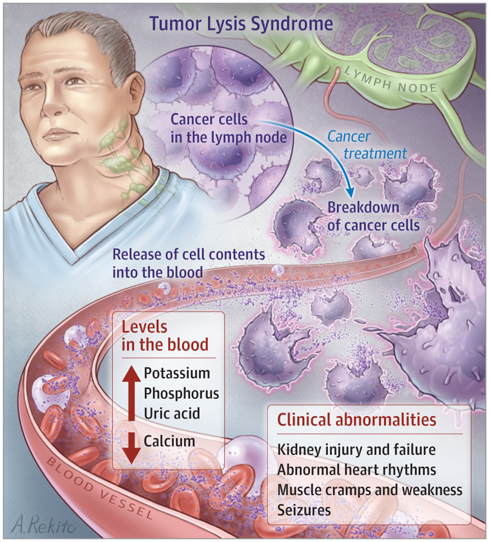
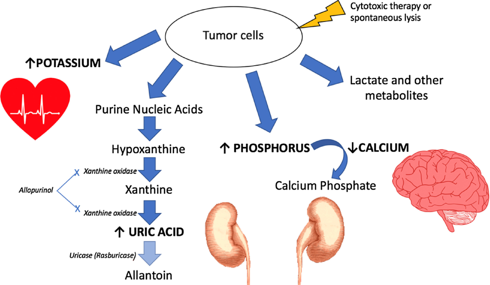
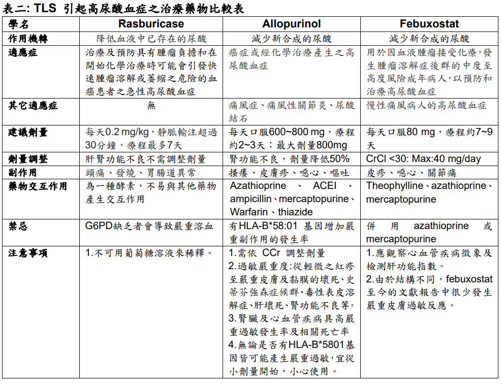

# Tumor Lysis Syndrome (TLS)

> Source: 林口長庚急診 OBN survival guide「Tumor lysis syndrome 診斷及治療」
> Related: [高血鉀](../07_Nephro/高血鉀.md)、[化療與免疫療法血液副作用](化療與免疫療法血液副作用.md)、[Anemia與TTP](Anemia與TTP.md)

## Key Points
- **血癌最近做化療又突然 AKI** ⇒ 一定要想到 Tumor lysis syndrome！記得加驗 **LDH**！
- 或是**新發現 hyperleukocytosis** 的 case（定義：**WBC >10 萬/µL**）
- 表現：**高鉀 + 高磷 + 高尿酸 + 低鈣 + AKI**

🖼️ 圖片轉錄：癌症治療讓 lymph node 等處的癌細胞崩解，細胞內容物釋放到血中 ⇒ **K、P、uric acid 上升，Ca 下降** ⇒ 臨床異常：腎損傷與腎衰竭、心律不整、肌肉抽筋無力、seizure

🖼️ 圖片轉錄（TLS 機轉）
- Tumor cells（cytotoxic therapy 或 spontaneous lysis）釋出：
  - **↑ Potassium** → 心臟（心律不整）
  - **Purine nucleic acids** → hypoxanthine → xanthine → **↑ uric acid**（xanthine oxidase 催化，**allopurinol** 抑制這兩步）→ allantoin（**uricase／rasburicase** 催化）
  - **↑ Phosphorus** → 和 Ca 結合成 calcium phosphate → **↓ Calcium**（腦：seizure）；calcium phosphate 和 uric acid 傷腎
  - Lactate 和其他代謝物

## Management
- **IV hydration + 降尿酸**；severe AKI with AEIOU 要考慮**洗腎**

### Hyperleukocytosis（WBC >10 萬）可考慮給 Hydroxyurea
- **作用機轉**：抑制 ribonucleotide reductase，阻斷 DNA 合成（S 期特異性）；快速降低 circulating blast／WBC，減少細胞溶解產物；口服後 24–48 小時內可見 WBC 下降
- **在急性白血病的應用**
  1. 初始白血球控制（debulking）：hyperleukocytosis（WBC >100,000/µL，特別是 AML 或 ALL 初診）；預防 leukostasis（減少腦、肺微血管阻塞）；減緩腫瘤崩解速度，降低 TLS 的尿酸、鉀、磷負荷
     - 時機：尚未開始化療前（如 cytarabine／anthracycline induction）先用 hydroxyurea 快速降低 WBC
  2. 橋接性治療（bridging）：診斷確立但還不能立即誘導化療（等待分型、基因檢驗或轉介）時，暫時控制 blast proliferation、穩定臨床狀況（呼吸、意識、腎功能）、避免化療立即引起大量 TLS
  3. 其他用途：CML（早期常用，現已被 TKI 取代）；sickle cell disease（促進 HbF 生成，不同機轉）
- **在 TLS 預防中的角色**：降低腫瘤負荷、減少瞬間嘌呤釋放；輔助 hydration 與 XO 抑制劑保護腎功能；**單獨使用無法直接降尿酸**，必須合併 allopurinol／febuxostat／rasburicase

## Medications
### 降尿酸藥物比較

🖼️ 圖片轉錄（表二：TLS 引起高尿酸血症之治療藥物比較表）
| | Rasburicase | Allopurinol | Febuxostat |
|---|---|---|---|
| 作用機轉 | 降低血液中**已存在**的尿酸 | 減少**新合成**的尿酸 | 減少**新合成**的尿酸 |
| 適應症 | 治療及預防有腫瘤負擔、開始化療時可能引發快速腫瘤溶解的血癌病人之急性高尿酸血症 | 癌症或化療產生的高尿酸血症 | 血液腫瘤接受化療、發生 TLS 中度至高度風險的成人，預防和治療高尿酸血症 |
| 其他適應症 | 無 | 痛風、痛風性關節炎、尿酸結石 | 慢性痛風的高尿酸血症 |
| 建議劑量 | 每天 0.2 mg/kg IV 超過 30 分鐘，療程最多 7 天 | 每天口服 600–800 mg，療程約 2–3 天；最大 800 mg | 每天口服 80 mg，療程約 7–9 天 |
| 劑量調整 | 肝腎功能不良不需調整 | 腎功能不良劑量降低 50% | CrCl <30：max 40 mg/day |
| 副作用 | 頭痛、發燒、腸胃道異常 | 搔癢、皮膚疹、噁心、嘔吐 | 皮疹、噁心、關節痛 |
| 藥物交互作用 | 是酵素，不易與其他藥物交互作用 | Azathioprine、ACEI、ampicillin、mercaptopurine、warfarin、thiazide | Theophylline、azathioprine、mercaptopurine |
| 禁忌 | ***G6PD 缺乏者會嚴重溶血*** | 有 HLA-B*58:01 基因增加嚴重副作用 | 併用 azathioprine 或 mercaptopurine |
| 注意事項 | 不可用葡萄糖溶液稀釋 | 依 CCr 調整劑量；過敏嚴重度從輕微紅疹到 SJS、TEN、肝壞死、腎功能不良；腎臟及心血管疾病者嚴重過敏發生率與死亡率高；無論有沒有 HLA-B*5801 都可能嚴重過敏，宜從小劑量開始 | 觀察心血管疾病徵象、監測肝功能；結構不同，文獻很少嚴重皮膚過敏 |

- ⚠️ 原文如此，待查證：Rasburicase 療程，健保規定寫「以三日為限」，比較表寫「最多 7 天」

### Rasburicase 健保給付規定
1. 限用於血液腫瘤（急性白血病和 high grade 淋巴瘤）患者之下列情形：
   1. 治療前或療程開始後，血清尿酸值高於 10 mg/dL；兒童高於 8 mg/dL
   2. 心臟或腎臟衰竭，無法忍受大量靜脈輸液
   3. Allopurinol 過敏者
2. 每日一至二劑，以三日為限
- Dosage：**0.2 mg/kg/day**
- 很貴；非血液腫瘤（ex. 頭頸癌）無法用健保 ⇒ 使用前請確認 indication

### Hydroxyurea
| 項目 | 說明 |
|---|---|
| 初始劑量 | 通常 50–100 mg/kg/day PO（或分 2–3 次），依白血球數調整；常見用法 500 mg 2–3 次/日 |
| 目標 | 白血球逐日下降至 <50,000/µL，但避免過度骨髓抑制 |
| 監測 | 每日 CBC、電解質、尿酸、腎功能 |
| 停藥時機 | 開始 definitive induction chemotherapy 後逐步停用 |

- 不良反應：骨髓抑制（WBC 或血小板過低時暫停或減量）；噁心、嘔吐、口腔潰瘍；指甲色素沉著、皮膚乾燥；長期使用可能慢性骨髓抑制或潛在致癌性（急性治療期短，風險極低）

## Clinical Pearls
- 血癌化療後 AKI → 想 TLS，加驗 LDH
