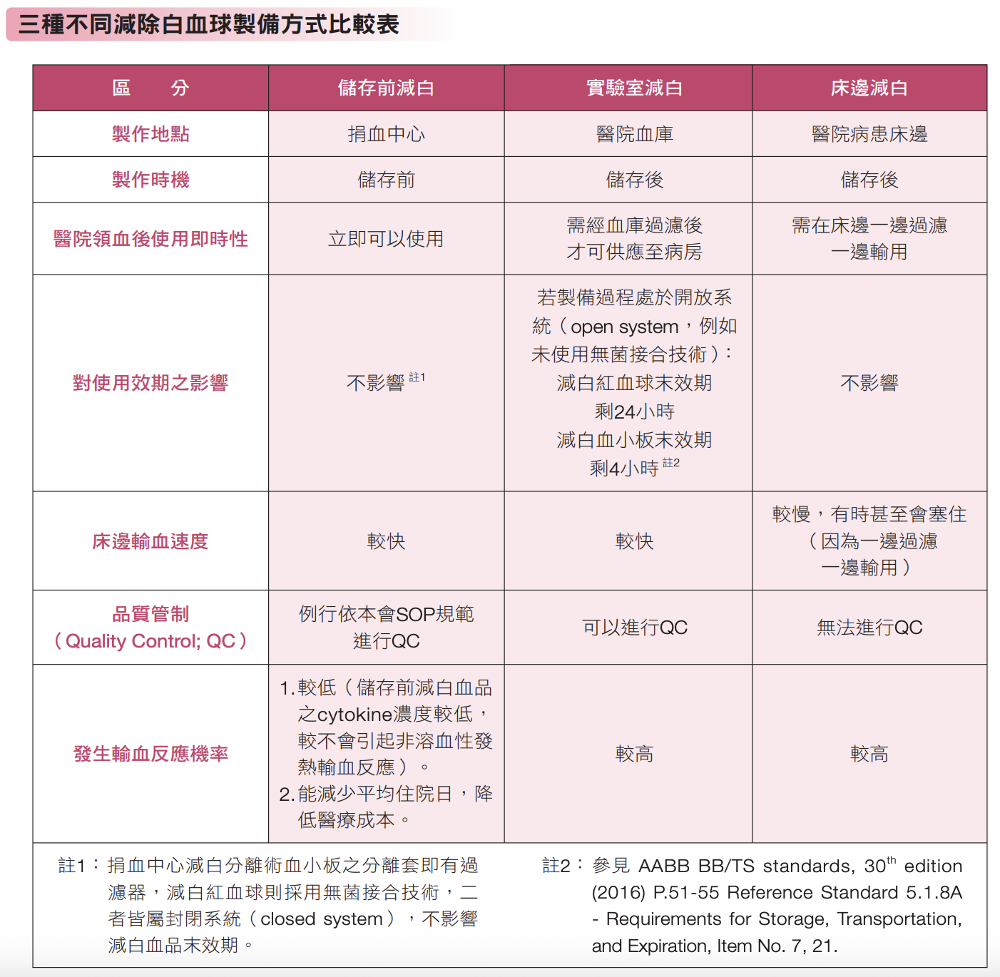

# Transfusion

> 📖 **Tintinalli**：[Ch238 Transfusion Therapy](https://drive.google.com/file/d/1ArlDLDBjixUK1Mtv1oVllv3_47r8NDUt/view)

> Source: Heptabase「輸血」「2025-12-17」；林口長庚急診 OBN survival guide「[血品洨知識](https://lnkemergency.xms.tw/media/5043)」（ver1.1 by 張亦鑫）「[備血/輸血](https://lnkemergency.xms.tw/media/2150)」（需登入）
> Related: [Primary Survey (ABCDE)](../01_急診流程與處置/初級評估ABCDE.md)（MTP）、[Hyperkalemia](../07_Nephro/高血鉀.md)、[Trauma Overview](../10_外傷與外科/Trauma總論.md)、[GI bleeding](../05_GI%20&%20GU/GI_bleeding.md)、[Anemia與TTP](Anemia與TTP.md)、[TIC外傷性凝血病變](../10_外傷與外科/TIC外傷性凝血病變.md)

## Key Points
- 大量輸血：要小心 Ca 低和 K 高（Heptabase 2025-12-17）
- 輸血也會發燒（見 [Fever](../04_Infection/發燒Fever.md)）

### 血品種類（OBN）
- **紅血球製品 RBC**：全血 whole blood；紅血球濃厚液 packed RBC（p-RBC）；減白紅血球濃厚液 leukocyte-poor RBC（LP-RBC）
- **血小板製品 PLT**：傳統血小板濃厚液（whole blood-derived platelets／platelet concentrate）；全血分離的減白血小板（LP-PC）；減白分離術血小板（leukocyte-reduced apheresis platelets）
- **血漿製品**：新鮮冷凍血漿 FFP；冷凍沈澱品 cryoprecipitate（CRYO）
- 特殊血品（不在討論範圍）：washed RBC（使用前洗掉血中蛋白或製備時加的甘油，存放時間短，約一天）；irradiated RBC（X 光或 γ 射線使 T 淋巴球去活化）；frozen RBC／irradiated PLT…

### 預估輸血效果＆保存時間（OBN）
- **P-RBC 每輸 3 cc/kg，Hb 上升 1**
- 美國：1U P-RBC 預期上升 1 g/dL（Hct 3%）；**台灣：1U P-RBC 預期上升 0.5 g/dL（Hct 1.5%）**
  - 台灣 1U 血品用 250 mL 全血製備，美國 1U 是 500 mL 全血
- RBC 1U 約 150 mL
- RBC 保存時間依保存液不同：CPDA-1 採血後 35 天；SAGM 採血後 42 天
- 血小板 1 PH 約等於 12U 傳統血小板濃厚液，內含約 3 × 10¹¹ 血小板；每 1 PH／12U 約可拉高血小板 30–60 × 10⁹/L
- 血小板本身壽命只有 7 天，國內離開體外後效期 5 天；保存在 22 ± 2°C 的振盪器中，血液培養 48 小時無長菌才會釋出

### 減除白血球（OBN）
- 一袋全血（約 250 mL）原本約有 (1–3) × 10⁹ 白血球；美國血庫標準，每單位減白紅血球濃厚液（250 mL 製備）白血球必須 <2.5 × 10⁶，約剩 1/1000
- 健保規定
  - 減白分離術血小板 7300 點，分離術血小板 4300 點
  - **減白血小板（LR-PH，93023C）適應症**：需長期輸血（再生不良性貧血、紅血球發育不良、慢性惡性腫瘤、藥物抑制骨髓造血等需頻繁輸血者）；器官或骨髓移植（避免 CMV 傳染）；免疫缺陷；過去輸血曾發生非溶血性發熱性輸血反應；預期會產生 HLA 抗體（需長期血小板輸注）
  - **減白紅血球（LR-RBC，93019C，925 點）已取消適應症，全面開放**；減白血小板因點數較高仍有適應症限制
- 減白可以在三個地方做

  

### 紅血球製品比較（OBN）
1. **全血（WB）**：缺點是讓病人承受不必要的 volume，易造成 TACO，幾乎已被淘汰；但在戰術緊急傷患救護（TECC／TCCC）、災難現場、急診大量輸血（MTP），**全血（特別是低效價 O 型全血，LTOWB）重新成為標準**——嚴重出血流失的是全血，直接補全血能最快同步提供攜氧能力與部分容積，後勤負擔最小
2. **紅血球濃厚液（p-RBC）**：離心移除大部分血漿，在不大幅增加 volume 下矯正貧血；但保留跟全血一樣多的白血球 ⇒ cytokine，易引起 FNHTR、CMV 傳染、HLA 異體免疫
3. **減白紅血球濃厚液（LP-RBC）**：過濾掉 99.9% 以上白血球，兼具低 volume 與少免疫發炎副作用；**台灣與國際趨勢已取代 p-RBC，為第一線紅血球製劑**

| | 全血 | p-RBC | LP-RBC |
|---|---|---|---|
| 主要成分 | 血小板與凝血因子會隨保存時間失效 | 紅血球、少量血漿、白血球 | 紅血球、少量血漿（白血球極低） |
| 台灣單袋容積 | 約 250 mL | 約 120–150 mL | 約 120–150 mL |
| 提升 Hb | 1U 約 0.5 g/dL | 1U 約 0.5 g/dL | 1U 約 0.5 g/dL |
| 白血球 | 高 | 高 | 極低（殘留 <5 × 10⁶） |
| 容積負荷 | 大 | 小 | 小 |
| 發燒與免疫反應 | 高 | 高 | 低（減少 FNHTR、CMV 感染） |

### 血小板製品比較（OBN）
1. **血小板濃厚液（PC）**：從一袋全血離心分離，未減白；易 FNHTR、CMV 傳播，長期輸注易 HLA 異體免疫；趨勢是全面減白（universal leukoreduction），以 LP-PC 取代
2. **全血分離的減白血小板（LP-PC）**：製程中加白血球過濾（台灣殘留需 <5 × 10⁶）；保留來源廣、適用急診外傷大量出血的機動性，又降低 FNHTR 和 CMV；但仍是隨機多位捐血者，成人每次需匯集 4–6 袋，長期仍有抗體風險
3. **減白分離術血小板（apheresis）**：單一捐血者上機邊抽邊分離並同步減白；一袋即一個治療劑量；抗原暴露最少（1 人），是預防或處理**血小板輸注無效（refractoriness）**的最佳選擇，適合血液科、化療或需反覆輸血的病人

| | PC | LP-PC | Apheresis |
|---|---|---|---|
| 白血球 | 高 | 極低（後端過濾） | 極低（製程中移除） |
| 捐血者暴露數 | 多人（4–6 人／劑） | 多人（4–6 人／劑） | 單人 |
| FNHTR 風險 | 最高 | 低 | 最低 |
| HLA 異體免疫 | 高 | 高 | 低 |
| 臨床定位 | 逐漸減少，不建議常規 | 急診、外傷、MTP | 需長期輸血或已產生抗體者 |
| 單袋容積 | 1U 約 30–40 mL | 1U 約 30–40 mL | 約 200–300 mL |
| 單袋血小板 | 約 0.3 × 10¹¹ | 約 0.3 × 10¹¹ | ≥3.0 × 10¹¹ |
| 成人單次處方 | 10–12U | 10–12U 或依 MTP | 1 袋 |
| 單次總容積 | 約 300–480 mL | 約 300–480 mL | 約 200–300 mL |

### 血漿製品（OBN）
- 基本上缺什麼補什麼；也有很多單獨的凝血因子藥物，但有費用問題
- **CRYO** 常用在 DIC 這類需要 fibrinogen 的情況
- **FFP** 有大量捐贈者血漿＝容積，輸太快會 volume overload
- 要矯正凝血又不想要副作用：**PCC** 很理想（但貴）
- FFP 本身 INR 約 1.5–1.7，所以 INR 沒比這更高就不適合輸 FFP 矯正；開始矯正的門檻約 **INR 2.0**（國外數據；⚠️ 原文如此，待查證：國內 FFP 約 INR 1.2？）
- 兩者都存放在 −18°C 以下，用前水浴融血：FFP 容積大，約 15–20 分鐘；CRYO 容積小但通常要多袋匯集，融化後不盡快輸注凝血因子活性會下降 ⇒ 極端急救或戰術醫療環境使用受限

| | FFP | CRYO |
|---|---|---|
| 製備 | 採血後 8 小時內分離血漿並快速冷凍 | FFP 在 1–6°C 緩慢融化後收集不溶的白色沉澱 |
| 單袋容積 | 約 120 mL | 1U 約 10–15 mL |
| 核心成分 | 全部凝血因子（含不穩定的 V、VIII） | 高濃度 fibrinogen、VIII、vWF、XIII |
| 成人單次處方 | 約 2–6U | 通常一次匯集 10–12U |
| 單次總容積 | 約 240–720 mL | 約 100–150 mL |
| 臨床目標 | 補充凝血因子 | DIC，針對性補 fibrinogen |

## Management

### 血小板 indication
- <5 萬 且 嚴重出血、DIC
- **<3 萬** 且 不危及生命的出血
- <10 萬 且 intracranial bleeding or multiple bleeding

### 輸血門檻（OBN）
- **RBC**：沒症狀建議 **Hb 7 g/dL**；ACS／HF 病人建議 **Hb 10 g/dL**
- **PLT**：預防性輸血小板，台灣血液科醫師門檻普遍抓 **2 萬**左右（ITP、TTP 等特殊血小板疾病不見得要輸很多 PLT，該照會血液科還是要照會）

### 臨床出血情境的輸血策略（OBN）
| | 創傷 | 腸胃道出血 | 產後大出血（PPH） |
|---|---|---|---|
| 目標 Hb | 7–9 g/dL（穩定後） | 7 g/dL（限制性策略） | >8 g/dL |
| MTP | 1:1:1（FFP:PLT:RBC）／whole blood | 不適用（嚴格容積管制） | 1:1:1（參考創傷） |
| 核心原則 | 損害控制復甦（DCR）／容許性低血壓 | 限制性輸血優於自由輸血 | 維持 fibrinogen >200 mg/dL |
| 輔助 | 早期 TXA、暖血輸注 | 血管收縮劑、內視鏡止血 | TXA、子宮收縮劑、CRYO |
| 實證等級 | 中（PROPPR 等試驗） | 高（證實可降死亡率與再出血） | 較低（多參考創傷數據） |

### 用血的緊急程度（OBN）
- **一般用血**：驗血型及抗體篩檢
- **緊急用血**（10 分鐘內要用血）：先驗血型，發相同血型血品，之後再完成抗體篩檢與交叉試驗
- **非常緊急用血**（5 分鐘內要用血）：血庫有紀錄的人發同血型；否則先發 **O 型**，之後再完成血型、抗體篩檢等
  - 非常緊急大量用血：**LPR O 型、FFP AB 型、PC 血型不限**

## Medications
（待補）

## Disposition
（待補）

## Clinical Pearls
（待補）
