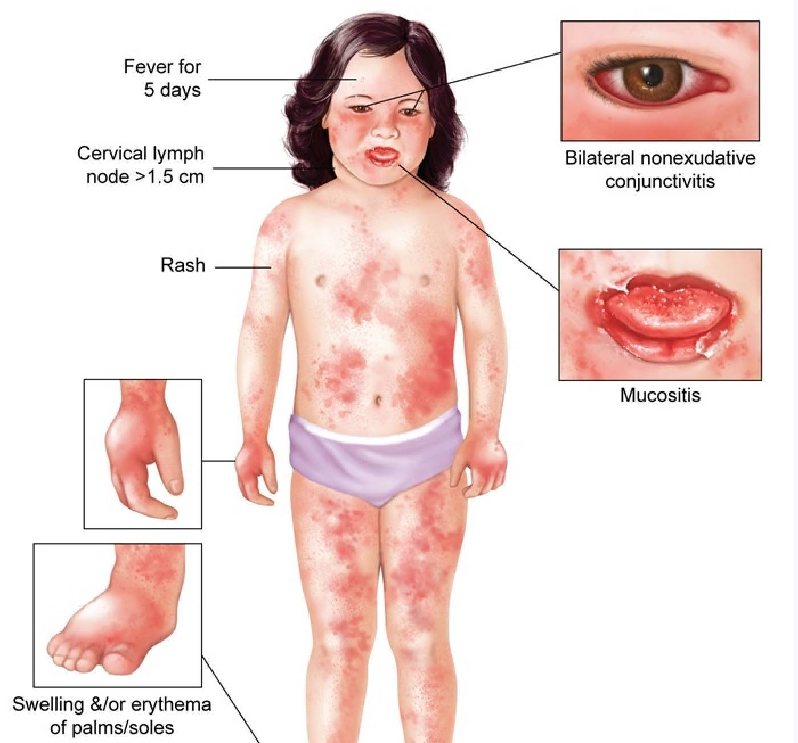

# Kawasaki Disease

> 📖 **Tintinalli**：[Ch129 › Kawasaki’s Disease](https://drive.google.com/file/d/1ngaZH4oNslJQSzEbltms04TT6MGy5O2j/view)｜[Ch142 › Kawasaki’s Disease](https://drive.google.com/file/d/12c37xiQpvTcJVFdSaaik5F9di0EgzsfO/view)

> Source: Heptabase「Kawasaki Disease」（參考：[馬偕衛教網站](https://www.mmh.org.tw/child/know_health_view.php?docid=73)）
> Related: [Fever](../04_休克與感染/發燒Fever.md)

## Key Points

### Criteria ⭐️⭐️
- **發燒五天 ⇒ 必要條件！**
- Fever + 4/5 符合
  1. **一**個嘴巴：**草莓舌**、**嘴唇紅腫乾裂**（oral-mucosal involvement）
  2. **兩**個眼睛：non-exudative conjunctivitis
  3. 頸部淋巴結腫大（cervical lymphadenopathy）
  4. **四**肢 → 手腳末稍出現**硬性浮腫**、紅斑、皮膚脫屑（extremity desquamation）
  5. 軀幹 ＋ 四肢：多形性紅疹（polymorphous rash）
- 🖼️ 圖片標示：fever for 5 days、cervical lymph node >1.5 cm、rash、bilateral nonexudative conjunctivitis、mucositis、swelling &/or erythema of palms/soles

## Management
（待補）

## Medications
（待補）

## Disposition
（待補）

## Clinical Pearls
（待補）
