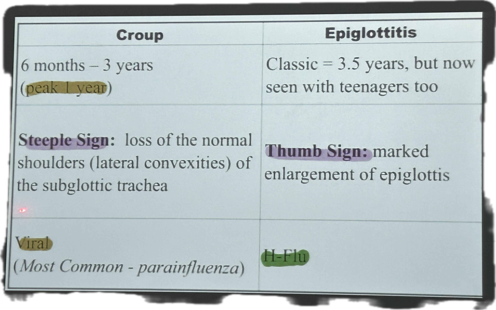

# Pediatric Wheezing & Stridor

> 📖 **Tintinalli**：[Ch127 Wheezing in Infants and Children](https://drive.google.com/file/d/1i-_ZjCnmAizmDbuDaXDuX8r8wBKJAmry/view)｜[Ch127 › Bronchiolitis](https://drive.google.com/file/d/11UnW4LkxqHPDKlKNOjHzN-sjJe6TgjPi/view)｜[Ch126 › Croup](https://drive.google.com/file/d/1D1Qk-dmFq52NxqXooBIuEhx1FeUFdAkY/view)

> Source: Notion「wheezing」（小兒科）；Heptabase「小兒科」白板圖片（Croup vs Epiglottitis）。聽聲音：[YouTube](https://www.youtube.com/watch?v=T4qNgi4Vrvo)
> 成人／POMD 喘鳴見 [哮喘與Stridor](../11_症狀導向/Wheezing與Stridor.md)；Asthma 見 [Asthma](../03_呼吸與酸鹼/Asthma.md)

## Key Points
### 依上中下呼吸道分類

**上呼吸道**
- 過敏性鼻炎
- 扁桃腺肥大
- 異物吸入
- 感染性鼻炎
- 鼻竇炎

**中呼吸道**
- 支氣管狹窄
- 淋巴腺腫大
- **會厭炎**
- 異物吸入
- 喉蹼、**軟喉症**
- **咽喉氣管支氣管炎（croup）**
- 縱膈腔淋巴腺病變
- 百日咳
- 食道氣管瘻管（TE fistula）
- 氣管狹窄、氣管軟化症
- 腫瘤
- 血管環
- 聲帶功能異常

**下呼吸道**
- Asthma
- 支氣管擴張症
- 支氣管肺發育不良
- 披衣菌（Chlamydia trachomatis）
- 感染、病毒性支氣管炎
- 慢性吸入
- 鬱血性[心衰竭](../02_CV/Heart%20Failure.md)
- 囊性纖維化
- 異物吸入
- 胃食道逆流（GERD）
- 過度換氣症候群
- 阻塞性細支氣管炎
- 肺血鐵質沉著症
- 吸入有毒物質（含香菸）
- 腫瘤

> 原筆記「出生一個月內的咳嗽」圖片來自 Obsidian，已遺失。

### Croup vs Epiglottitis（Heptabase 圖片，上課翻拍）
🖼️ 圖片轉錄
| | Croup | Epiglottitis |
|---|---|---|
| 年齡 | 6 months – 3 years（peak 1 year） | Classic = 3.5 years, but now seen with teenagers too |
| X-ray | **Steeple sign**：loss of the normal shoulders（lateral convexities）of the subglottic trachea | **Thumb sign**：marked enlargement of epiglottis |
| 病原 | Viral（most common – parainfluenza） | H-Flu |

## Management
（待補）

## Medications
（待補）

## Disposition
（待補）

## Clinical Pearls
（待補）
