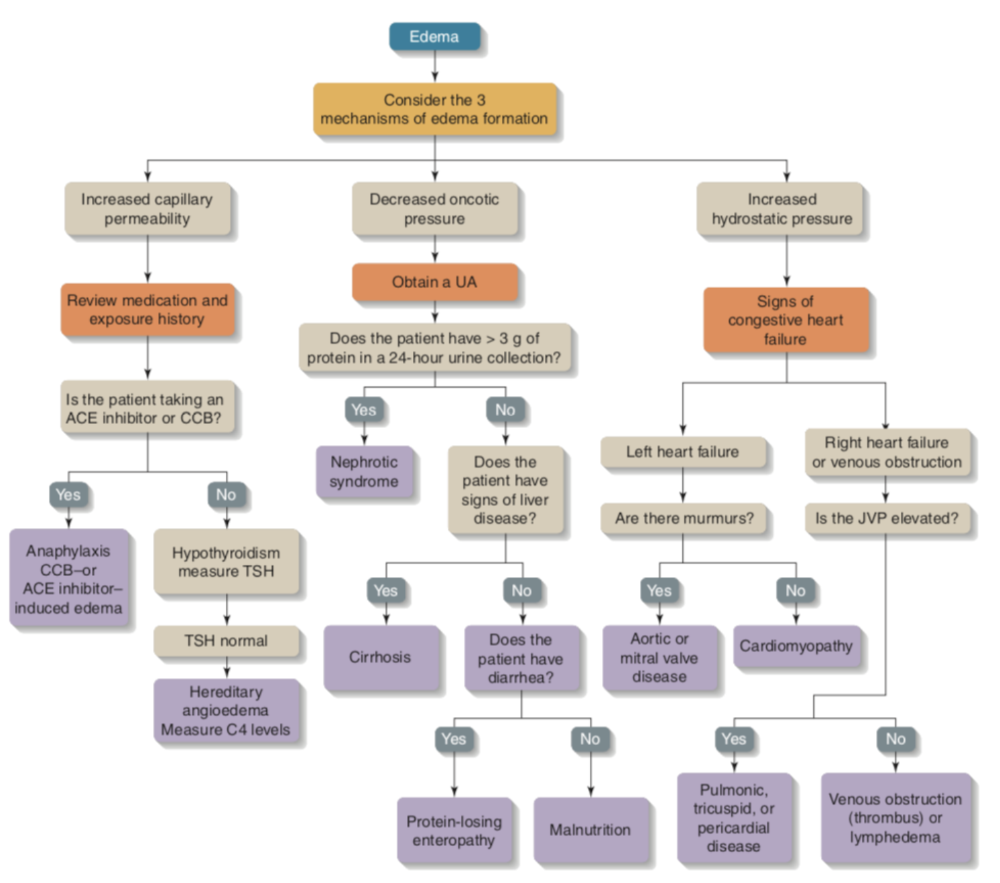

# Edema

> Source: POMD「水腫」；Heptabase「🔎水腫(Edema)」白板（水腫 mindmap、Edema 流程圖、CHF的PE）

## Key Points
- **單腳腫**：cellulitis、DVT
- PE 的快速 history taking 也要問單腳腫/痛（見 [Pulmonary_Embolism](../02_心血管/Pulmonary_Embolism.md)）
- 全身水腫合併低血鈉 → 想心肝腎（見 [低血鈉與SIADH](../07_電解質與內分泌急症/低血鈉與SIADH.md)）
- Right heart failure：JVD、肝腫大、下肢水腫（見 [Heart_Failure](../02_心血管/Heart_Failure.md)）

### 水腫機轉（Heptabase mindmap，微血管的循環）
1. 微血管的 **hydrostatic pressure（靜水壓）增加**
   - Fluid overload：heart failure、腎臟疾病
   - 靜脈阻塞：DVT、portal vein HTN、SVC syndrome
   - 懷孕
2. 微血管的**通透性增加**
   - 血管受損：burn
   - 發炎
   - pre-capillary sphincter 擴張，導致水分滲漏出微血管，產生水腫
   - **ACEi、NSAIDs、Steroid、Estrogen**
3. 血液中的 **oncotic pressure（膠體滲透壓）降低**（albumin 低）
   - 製造 ↓（肝衰竭）：cirrhosis
   - 排出 ↑：腎病症候群（nephrotic syndrome）
4. Interstitial 中的 **oncotic pressure 增加**：黏液性水腫（myxedema）
5. **淋巴循環阻塞**
   - **術後清淋巴結**，導致淋巴循環阻塞，造成 lymphedema
   - 象皮病（血絲蟲會入侵淋巴系統）

### Edema 流程圖（Heptabase 圖片）
🖼️ 圖片轉錄
- Consider the 3 mechanisms of edema formation
  - **Increased capillary permeability** → review medication and exposure history → is the patient taking an ACE inhibitor or CCB?
    - Yes → anaphylaxis、CCB- or ACE inhibitor-induced edema
    - No → hypothyroidism, measure TSH → TSH normal → hereditary angioedema, measure C4 levels
  - **Decreased oncotic pressure** → obtain a UA → >3 g of protein in a 24-hour urine collection?
    - Yes → nephrotic syndrome
    - No → signs of liver disease? Yes → cirrhosis；No → diarrhea? Yes → protein-losing enteropathy；No → malnutrition
  - **Increased hydrostatic pressure** → signs of congestive heart failure
    - Left heart failure → murmurs? Yes → aortic or mitral valve disease；No → cardiomyopathy
    - Right heart failure or venous obstruction → JVP elevated? Yes → pulmonic, tricuspid, or pericardial disease；No → venous obstruction（thrombus）or lymphedema

## Management
（待補）

## Medications
（待補）

## Disposition
（待補）

## Clinical Pearls
（待補）

## Related
- [軟組織感染](../04_休克與感染/軟組織感染.md)、[DVT與抗凝血藥物](../02_心血管/DVT與抗凝血藥物.md)
