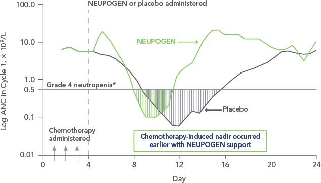

# Hematologic Adverse Effects of Chemo & Immunotherapy

> Source: Notion「化療、免疫療法之副作用」（醫學筆記文章撰寫）。Febrile neutropenia 抗生素見 [兒童抗生素使用](../09_小兒急診/兒童抗生素使用.md)。胃口差可開 Megest。

## Key Points
### Neutropenia 為什麼 nadir 在第 7–10 天？
1. Neutrophil 成熟過程：HSC → myeloblast → promyelocyte → myelocyte → metamyelocyte → band → 成熟 neutrophil，約需 **7 天**
2. 骨髓儲備池可撐 **4–6 天**
3. 化療打的是**分裂中的 progenitors**（myeloblast、promyelocyte、myelocyte）→ 新的補不上
4. 血中成熟 neutrophil（壽命數小時到數天）＋儲備池用完後 → **第 7–10 天到最低點（nadir）**

- **感染風險最高：nadir（化療後 7–10 天）**
- **G-CSF**：加速 progenitor 恢復、**縮短** nadir 期；不能完全預防 neutropenia

  

### Chemotherapy vs Immunotherapy（ICIs）
| | Chemotherapy | Immunotherapy（ICIs） |
|---|---|---|
| 機制 | 直接毒殺快速分裂的造血 progenitors | 自體免疫樣反應攻擊造血細胞或血液成分 |
| 起始時間 | 可預測，7–10 天 nadir | 不可預測，數週到數月後 |
| 型態 | **全血球下降**常見 | **單一系統**為主：ITP、AIHA、罕見 aplastic anemia、少數 neutropenia |
| 嚴重度 | 劑量依賴、可逆 | 非劑量依賴，可能持續或復發 |
| 治療 | 支持性：輸血、G-CSF、抗生素 | 停 ICI＋**免疫抑制**（steroids、IVIG、rituximab、cyclosporine） |
| 可逆性 | 多數可恢復 | 有時不可逆 |
| 警訊 | 可預測 → 可 prophylaxis | 無法預測 → 密切監測 |

## Management
（待補）

## Medications
（待補）

## Disposition
（待補）

## Clinical Pearls
- 化療病人發燒：先問最後一次化療是哪天，算是否落在 nadir
