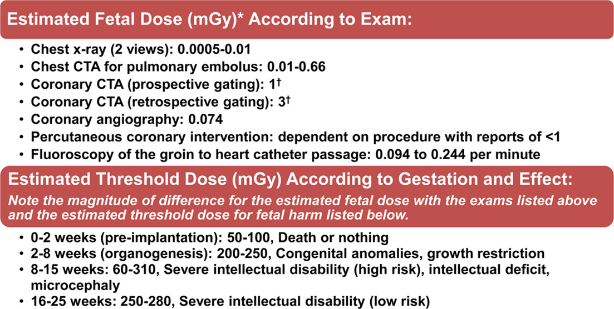
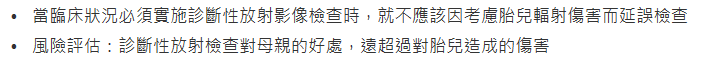
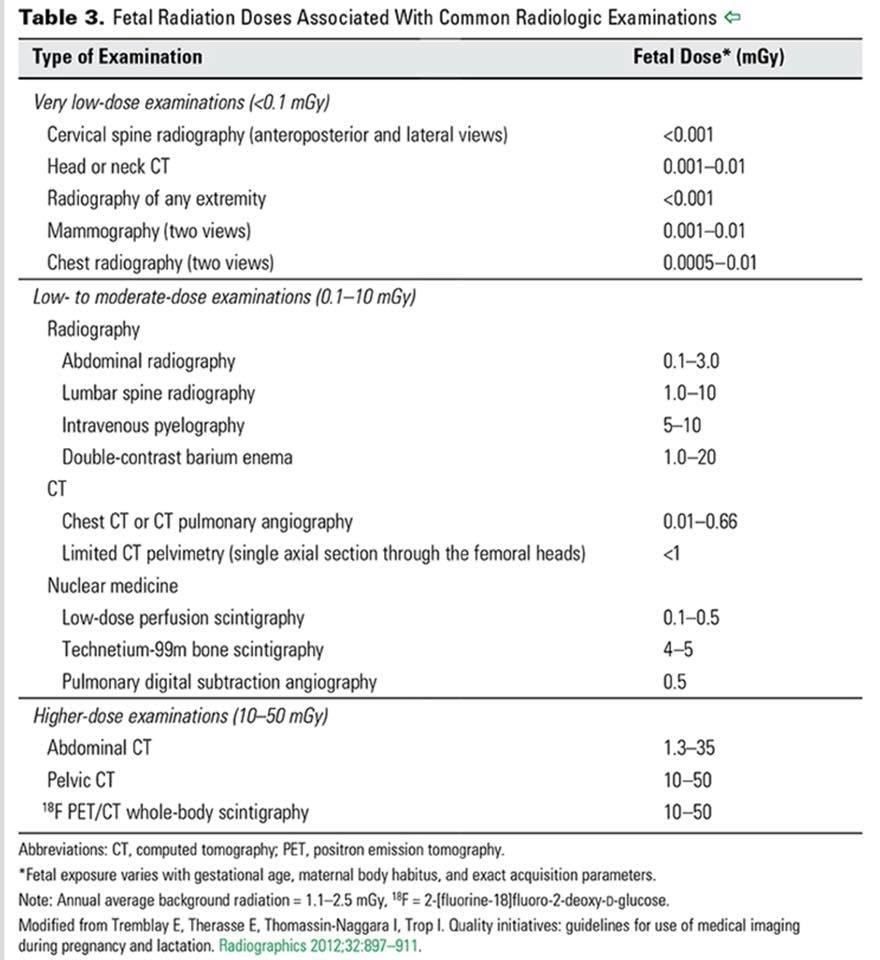
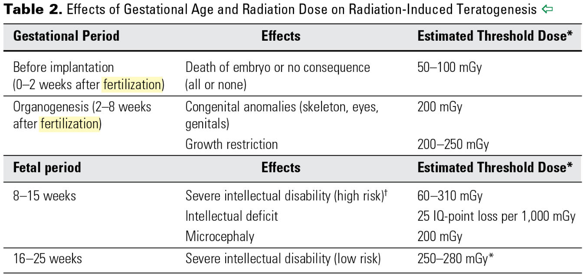

# ED Imaging Considerations (MRI, Contrast Allergy, Pregnancy)

> Source: 林口長庚急診 OBN survival guide「在急診急做MRI?」「懷疑顯影劑過敏可以驗什麼?」「孕婦與放射線」（[MRI](https://lnkemergency.xms.tw/media/2679)、[顯影劑過敏](https://lnkemergency.xms.tw/media/2678)、[孕婦與放射線](https://lnkemergency.xms.tw/media/3553)，需登入）
> Related: [Stroke](../06_Neuro/01_中風Stroke.md)、[皮疹與藥物過敏](皮疹與藥物過敏.md)、[胎盤早期剝離](胎盤早期剝離.md)、[ACS](../02_CV/ACS急性冠心症.md)（孕婦 ACS）

## 急診做 MRI 的時機
- 會診專科後建議
- 高度懷疑腦中風，而 CT／CTA 無法給出答案
- 懷疑脊椎神經壓迫合併神經學異常
- 孕婦無法接受腹部電腦斷層

## 懷疑顯影劑（藥物）過敏：驗 Tryptase
- **Tryptase**（健保）：建議在 **15–120 分鐘內**抽血
- 用來鑑別是否為藥物引起的休克

## 孕婦與放射線
- 結論：**50 mSv 以下不會對胎兒造成影響**；CT 不直接照腹部～骨盆腔，基本上都不會超過安全劑量
- 當臨床狀況必須做診斷性放射影像檢查時，**不應該因為擔心胎兒輻射傷害而延誤檢查**；診斷性放射檢查對母親的好處，遠超過對胎兒造成的傷害
- 單位換算
  - **Gy（Gray）** = J/kg = 每公斤組織吸收的能量（游離輻射暴露劑量）
  - **Sv（Sievert）** = Gy × 轉換因子 = 依生物效應校正後的劑量
  - 對 diagnostic X-ray 等光子游離輻射：**1 Gy = 1 Sv**

🖼️ 圖片轉錄（AHA，Estimated fetal dose，mGy）
- Chest X-ray（2 views）：0.0005–0.01
- Chest CTA for PE：0.01–0.66
- Coronary CTA：prospective gating 1；retrospective gating 3
- Coronary angiography：0.074
- PCI：依 procedure，報告 <1
- Fluoroscopy（groin 到心臟導管）：0.094–0.244 / min

ACOG「Guidelines for Diagnostic Imaging During Pregnancy and Lactation」：

🖼️ 圖片轉錄（Fetal radiation doses，mGy）
| 分類 | 檢查 | 胎兒劑量 |
|---|---|---|
| Very low（<0.1） | C-spine X-ray | <0.001 |
| | Head or neck CT | 0.001–0.01 |
| | 四肢 X-ray | <0.001 |
| | Mammography | 0.001–0.01 |
| | Chest X-ray | 0.0005–0.01 |
| Low–moderate（0.1–10） | Abdominal X-ray | 0.1–3.0 |
| | L-spine X-ray | 1.0–10 |
| | IVP | 5–10 |
| | Double-contrast barium enema | 1.0–20 |
| | Chest CT／CTPA | 0.01–0.66 |
| | Limited CT pelvimetry | <1 |
| | Low-dose perfusion scintigraphy | 0.1–0.5 |
| | Tc-99m bone scintigraphy | 4–5 |
| | Pulmonary DSA | 0.5 |
| Higher（10–50） | Abdominal CT | 1.3–35 |
| | Pelvic CT | 10–50 |
| | 18F PET/CT whole body | 10–50 |

- 年平均背景輻射 = 1.1–2.5 mGy

| 時期               | 效應                    |                       估計閾值 |
| :--------------- | --------------------- | -------------------------: |
| 著床前（受精後 0–2 週）   | 胚胎死亡或沒影響（all or none） |                 50–100 mGy |
| 器官形成期（受精後 2–8 週） | 先天異常（骨骼、眼、生殖器）        |                    200 mGy |
|                  | 生長遲滯                  |                200–250 mGy |
| 8–15 週           | 嚴重智能障礙（high risk）     |                 60–310 mGy |
|                  | 智力缺損                  | 每 1,000 mGy 少 25 IQ points |
|                  | 小頭症                   |                    200 mGy |
| 16–25 週          | 嚴重智能障礙（low risk）      |                250–280 mGy |

## Clinical Pearls
- 孕婦該照就照：50 mSv 以下不影響胎兒，頭頸胸 CT 劑量都很低
