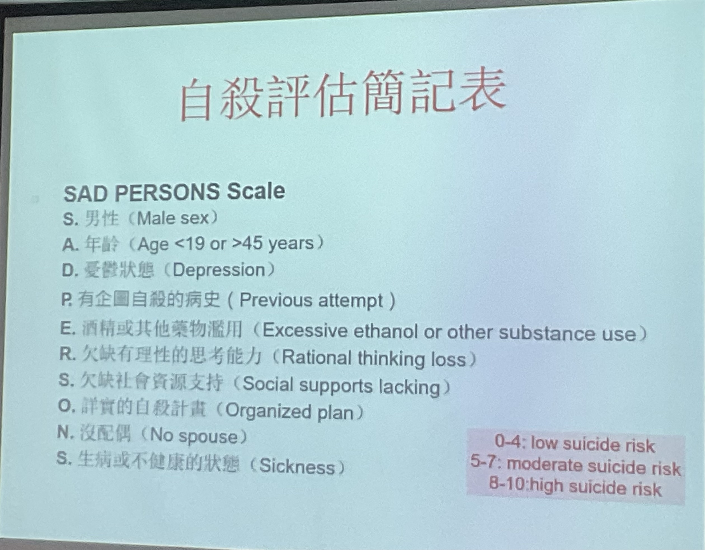
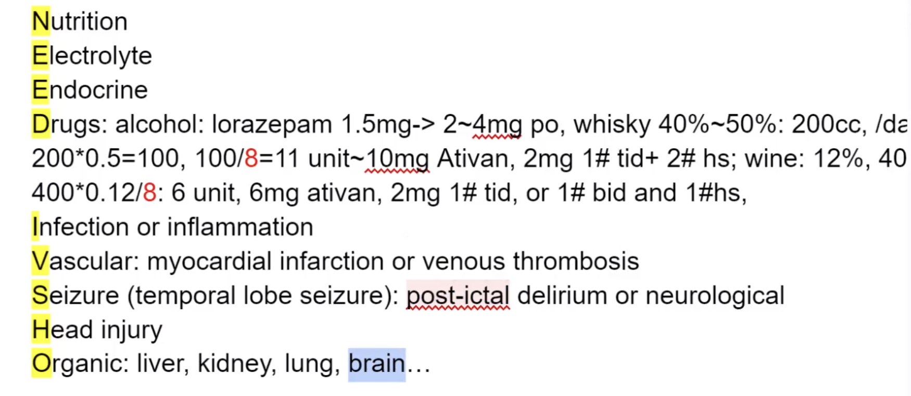

# Psychiatric Emergencies

> 📖 **Tintinalli**：[Ch286 Mental Health Disorders: ED Evaluation and Disposition](https://drive.google.com/file/d/1Uq-4LaxDCAANrWcePv6fD-Nf_P0hTen5/view)｜[Ch289 › Determination of Suicide Risk](https://drive.google.com/file/d/1SaCJZ4Hbbl6-6kQzBnWsjAiaxtmOduHr/view)｜[Ch180 › Extrapyramidal Symptoms](https://drive.google.com/file/d/1wrZqcgstzhf8PzYVNAsfhjEI_Cxj7PY0/view)｜[Ch185 › Alcohol Withdrawal Syndromes](https://drive.google.com/file/d/1lF3XoMAJGxLn-KygApmxzQkcym4RVX2j/view)｜[Ch168 › Delirium](https://drive.google.com/file/d/1mNRwK_vOUWGuhGlKF2SuPCl0Ty01UG0B/view)

> Source: Heptabase「精神科」白板（自殺評估簡記表(Sad person scale)、精神科病人評估、Catatonia）「EPS 錐體外徑症候群」「Alcohol withdrawal」「Delirium譫妄」（NEED IVSHO 圖片中的 alcohol 換算）「2025-12-11（anticholinergic）」
> Related: [Altered Mental Status](../06_神經/意識改變_AMS.md)（Delirium）、[Common ED Medications](../01_急診流程與處置/急診常用藥物.md)（安眠藥、Haldol）

## Key Points

### 自殺評估簡記表（SAD PERSONS scale）
- 在急診好用！可以快速的評估看看要不要會診精神科
- 最明顯的警訊：有 45% 人在自殺前曾經清楚表達自殺意圖
- 🖼️ 圖片轉錄
  - **S**：男性（Male sex）
  - **A**：年齡（Age <19 or >45 years）
  - **D**：憂鬱狀態（Depression）
  - **P**：有企圖自殺的病史（Previous attempt）
  - **E**：酒精或其他藥物濫用（Excessive ethanol or other substance use）
  - **R**：欠缺有理性的思考能力（Rational thinking loss）
  - **S**：欠缺社會資源支持（Social supports lacking）
  - **O**：詳實的自殺計畫（Organized plan）
  - **N**：沒配偶（No spouse）
  - **S**：生病或不健康的狀態（Sickness）
  - 0–4：low suicide risk；5–7：moderate suicide risk；8–10：high suicide risk

### 精神科病人評估（松德上課）
- **Thought**
  - Thought form（思考形式）
    - Loosening of association：偏思覺失調
    - Flight of idea：偏 bipolar
  - Thought content（內容）
    - **Delusion 妄想**：不合理的推論 + 深信不疑
- **Perception**
  - Hallucinations：缺乏外在知覺刺激，卻有感官知覺
    - Delirium 的特徵：**視幻覺**！
  - Illusion：有外在知覺刺激，但是感知是錯的
    - 是短暫的，**不**需要用 antipsychotics

### EPS 錐體外徑症候群
1. **肌張力異常（Dystonia）**：像中風一樣 — 眼球上吊、牙關緊閉、嘴巴歪斜
2. 靜坐不能（Akathisia）
3. Parkinsonian syndrome
   1. **Resting tremor**：雙腿、雙腳或下巴也會有抖動的現象
   2. 肌肉僵直 rigidity：要活動病人關節的時候，會碰到阻力、肢體僵硬
   3. 動作遲緩、講話速度緩慢、音調呆板、臉部表情僵硬（撲克臉）、眨眼頻率變少
   4. 姿勢保持反射障礙 postural instability：出現前傾姿勢、小碎步、走路時向前衝等狀態
4. 運動困難（Dyskinesia）

### Catatonia
- 參考：NEJM review（原卡連結為院內代理網址）
- **DSM-5 diagnostic criteria for catatonia（3/12）**
  1. **Stupor** – No psychomotor activity; not actively relating to the environment.
  2. **Catalepsy** – Passive induction of a posture held against gravity.
  3. **Waxy flexibility** – Slight, even resistance to positioning by the examiner.
  4. **Mutism** – Little or no verbal response (excluding known aphasia).
  5. **Negativism** – Opposition or no response to instructions or external stimuli.
  6. **Posturing** – Spontaneous and active maintenance of a posture against gravity.
  7. **Mannerism** – Odd, circumstantial caricature of normal actions.
  8. **Stereotypy** – Repetitive, non-goal-directed movements (e.g., hand-flapping).
  9. **Agitation** – Not influenced by external stimuli.
  10. **Grimacing** – Facial expressions not related to external stimuli.
  11. **Echolalia** – Mimicking another's speech.
  12. **Echopraxia** – Mimicking another's movements.

## Management
（待補）

## Medications

### EPS
- 解法：**直接打 Akineton（Biperiden）**

### Catatonia
- **Lorazepam** IV 1–2 mg — may cause rapid improvement within minutes
- 如果症狀改善 ⇒ 可以證實診斷！（表示更像 catatonia！）

### Alcohol withdrawal
- 治療：給 BZD
- 神內愛給 Chlordiazepoxide（**Librium**）
- 酒精如何換算成 Ativan？
  - 藥物劑量：換算成酒精的單位（**克數除以 8**）→ **11 unit → 10 mg** Ativan（Lorazepam）
  - 🖼️ 圖片轉錄（NEED IVSHO 投影片的 Drugs 段）：alcohol：lorazepam 1.5 mg → 2～4 mg po；whisky 40%～50%：200 cc/day，200 × 0.5 = 100，100/8 = 11 unit ～ 10 mg Ativan，2 mg 1# tid + 2# hs；wine：12%，400 × 0.12/8：6 unit，6 mg Ativan，2 mg 1# tid，or 1# bid and 1# hs

  

### Anticholinergic 與老人（Heptabase 2025-12-11）
- Anticholinergic 不要用在老人身上！！！！（例如：第一代抗組織胺）
- 會讓老人變笨變亂（想一想 Donepezil = 增加 cholinergic 的機轉）

## Disposition
- SAD PERSONS scale：快速評估要不要會診精神科（分數分級見上）

## Clinical Pearls
（待補）
