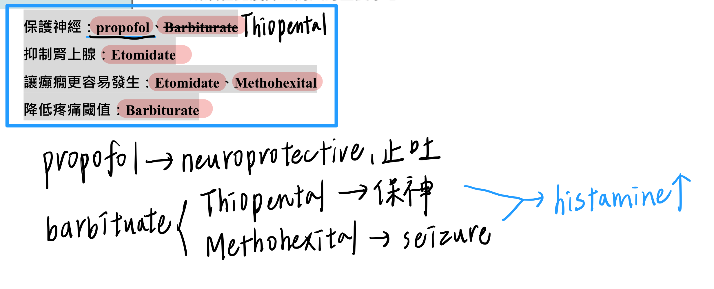
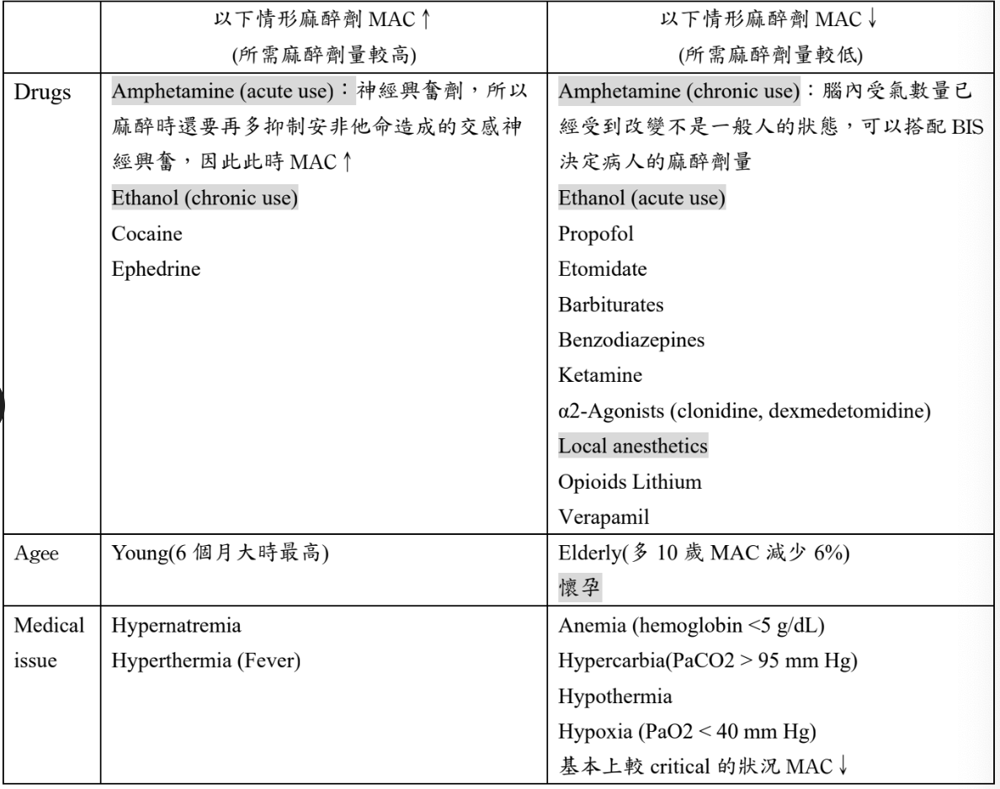
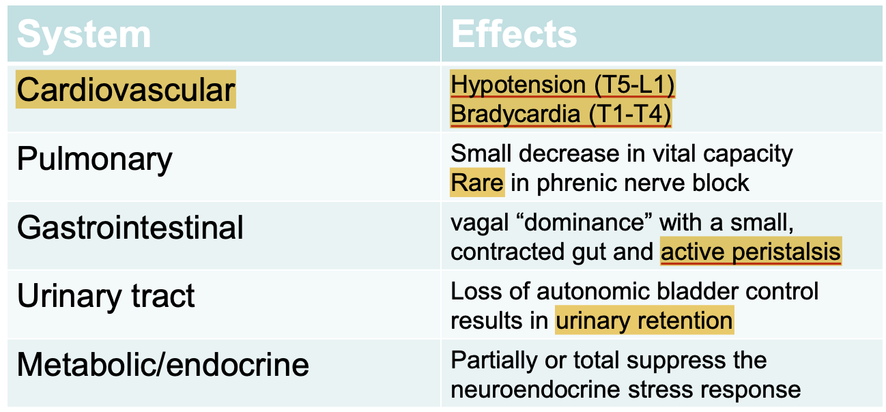
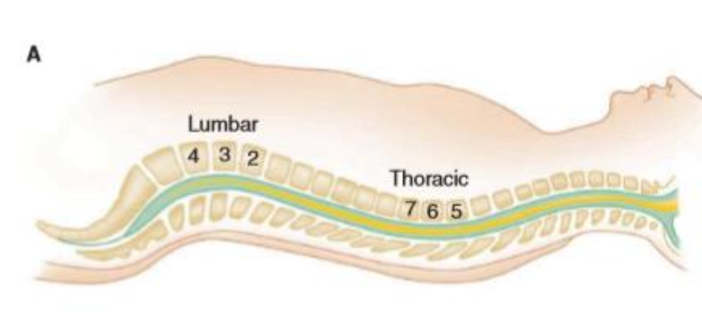

# Anesthesia Essentials

> 📖 **Tintinalli**：[Ch35 Acute Pain Management](https://drive.google.com/file/d/1y8Rv4ZXJPUz5REnD31DhQG7kd9iB9Qzv/view)｜[Ch36 Local and Regional Anesthesia](https://drive.google.com/file/d/1dFKxOhCm5ebELkYo09ieJzsDI_sX81WU/view)｜[Ch37 Procedural Sedation and Analgesia in Adults](https://drive.google.com/file/d/1I-w0MQzAOqNUeDb1LfAX7qrp4mCG5LRv/view)

> Source: Notion「麻醉科lecture」（實習考前整理）。RSI 藥物見 [插管與氣道](../01_急診流程與處置/插管與氣道.md) 與 R1 Checklist。

## Key Points
### 考前大補帖

### Opioid
- Morphine ⭐ 會造成**呼吸抑制** → 解藥 **naloxone**

### 全身麻醉四要素
1. Loss of consciousness
2. Amnesia
3. Analgesia
4. Paralysis
- 分吸入性、非吸入性（IV）兩大類

### 吸入性麻醉
- 機轉：活化 GABA receptor、抑制 glutamate/nicotinic receptor
- 深度監測：vital sign、**BIS**（0–100，越高越清醒；40–60 最佳；30–60 為全身麻醉深度；>60 可能甦醒）
- Uptake：**血中溶解度越低（blood/gas coefficient 越低）→ induction 與清醒越快**；另受 alveolar blood flow、肺泡與靜脈分壓差影響
- 主要排除：**呼氣**
- **MAC**：使 50% 病人對標準刺激（如切皮）不動的肺泡最低濃度

  

- **N2O（笑氣）**：只有止痛（無 amnesia、無 paralysis），**不能單獨當麻醉藥**；不會惡性高熱；久暴露 → 骨髓抑制（大球性貧血）、周邊神經病變；**禁忌：pneumothorax、air embolism**（會讓氣體膨脹）
- **Desflurane**：會惡性高熱；與 soda lime 產生 **CO**
- **Sevoflurane**：會惡性高熱；與 soda lime 產生腎毒性 **Compound A**
- **Soda lime**：吸收 CO2；含 ethyl violet，飽和時由白轉**藍紫色**，超過一半就要換

### Neuraxial anesthesia
- Spinal cord 末端：小孩 **L3**、大人 **L1 以上**；dura 末端 **S1–S2**
- 對各系統的影響

  

- **Spinal**：L3–4 或 L4–5 進針；仰躺時 lumbar 最高、T6 最低 → 比重適當時藥物最多沉到 T6，不易影響 T4 以上交感神經；比重比 CSF 低就可能往上跑；用 dextrose 或 sterile water 調整比重（isobaric、hypobaric、hyperbaric）

  

- **PDPH（post-dural puncture headache）**：約 1/100，low pressure headache — CSF 漏出、腦失去支撐下沉，牽扯痛覺敏感構造

### Peripheral nerve block
- Axillary block 的 **tourniquet pain**：musculocutaneous、medial cutaneous 等神經較早分出麻不到，需單獨阻斷

## Management
（待補）

## Medications
（待補）

## Disposition
（待補）

## Clinical Pearls
- LP 後頭痛想 PDPH
- 氣胸病人不要用笑氣
