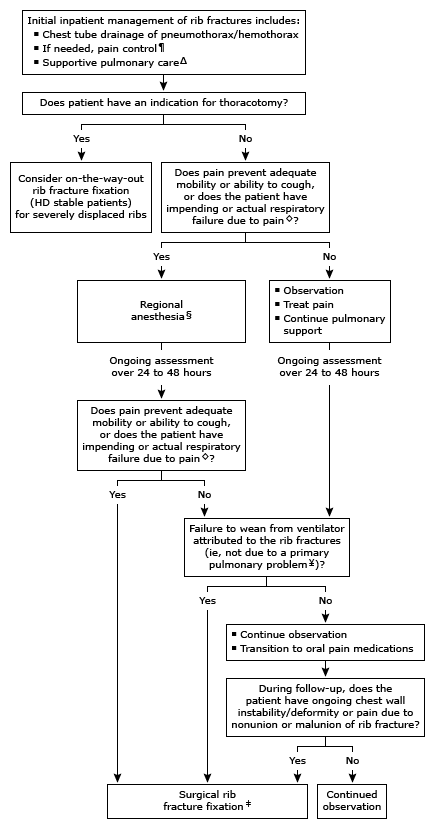

#  Rib fracture
### 什麼時候要開刀？
1.  Flail chest　
	- Flail chest 更容易插管、上呼吸器 ⇒ **early surgery**
2. >4 根肋骨 displaced（骨頭完全沒連在一起）
- 手術建議固定 **4–9 肋**（1–2 釘不到且有 scapula 擋住、11–12 浮肋，對呼吸貢獻小）
- 手術適應症：呼吸衰竭或 flail chest、嚴重胸壁變形、無法脫離呼吸器（非 contusion 造成）、因其他原因開胸時順便固定（on-the-way-out fixation）、nonunion/malunion 持續疼痛
### Management (non-surgery)
- 長庚肋骨 team routine
	1. [CXR](../03_Chest/Chest_X-Ray判讀.md) QD ×3 (排除氣血胸)
	2. 止痛 by clock　
	3. 化痰（因為咳痰能力不好）　
	4. 吸 Triflo（肺擴張、把血擠出去）
- 初始住院：thoracostomy tube 引流、fluid management、DVT prophylaxis
- 止痛（mobility 或咳痰能力不足時）：acetaminophen、NSAID、**區域麻醉**；注意呼吸抑制
- Supportive：incentive spirometry（防插管）

### Flail chest
- 定義：連續 3 根肋骨有 2 處以上骨折
- 臨床表現：胸壁相悖起伏（**paradoxical motion**）→ 吸氣時內縮，呼氣時外擴
- Management
  1. 體液補充
  2. **止痛（很重要！）**：nerve block、epidural、肋間固定帶
  3. [插管](../01_急診流程與處置/插管與氣道.md) + 呼吸器
  4. ORIF：很少需要手術！
  - ⚠️ 原文如此，待查證：Heptabase 版寫「ORIF 很少需要手術」，Notion 版寫 flail chest ⇒ early surgery

- **ICU indication**：>5 根肋骨骨折、multiple displaced、flail chest；tachypnea、SpO2 <92%

  

## Hemothorax 手術適應症（urgent thoracotomy）
- [Chest tube](../01_急診流程與處置/管路與Procedure.md) 24 小時引流 **1500 ml**
- 置管後 **300–500 ml/hr 連續 2–4 小時**
- 大血管或胸壁損傷
- Pericardial tamponade
