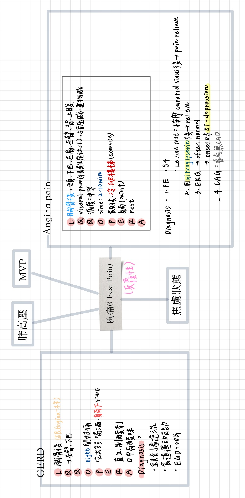

# Chest Pain

> 📖 **Tintinalli**：[Ch48 Chest Pain](https://drive.google.com/file/d/1uXHAWfGnHVxVqiK-AIN7so5yijk_njIy/view)

> Source: POMD「胸痛(Chest Pain)」＋ R1 Checklist；Heptabase「胸痛」「有哪些症狀是noncardiac pain」
> Related: [ACS](../02_CV/ACS急性冠心症.md)、[Aortic_Dissection](../02_CV/Aortic_Dissection.md)、[Pulmonary_Embolism](../02_CV/Pulmonary_Embolism.md)、[Pneumothorax](../03_呼吸與酸鹼/Pneumothorax.md)

## Key Points
### 致命五診斷（R1 Checklist）
1. ACS
2. PE
3. Aortic dissection
4. Tension pneumothorax
5. Esophageal rupture

### 哪些症狀是 noncardiac pain（Heptabase）
- Pleuritic
- 可以用手指 localized
- 時間太短（幾秒鐘）或是太長（超過一天）⇒ ACS 痛通常會**超過 10 分鐘～幾小時**（if STEMI）
- 跟姿勢有關
- 其他 myocardial ischemia 的相關症狀見 [ACS](../02_CV/ACS急性冠心症.md)

### 反覆性胸痛

### AMI 的 PE
- **冰冷、流汗、蒼白、發紺**
- 有 **CHF** 的 sign，但沒有**周邊水腫**

### Aortic dissection 的 PE
- 剝離到分支動脈造成阻塞：
  - 脊椎動脈
  - 手腳循環
  - 腎動脈：高血壓、寡尿
  - Mesenteric a.：腸梗塞、腹痛、腸阻塞
  - 急性 AR
  - 冠狀動脈：AMI
  - 破入心包膜 → tamponade
- 診斷：**[CXR](../03_呼吸與酸鹼/Chest_X-Ray判讀.md) 縱膈腔主動脈變寬**（且越來越寬）、主動脈攝影、TEE、CT/MRI
- 懷疑 aortic dissection ⇒ 做 **CTA of Aorta**（Heptabase）

## Management
（待補）

## Medications
（待補）

## Disposition
（待補）

## Clinical Pearls
（待補）
