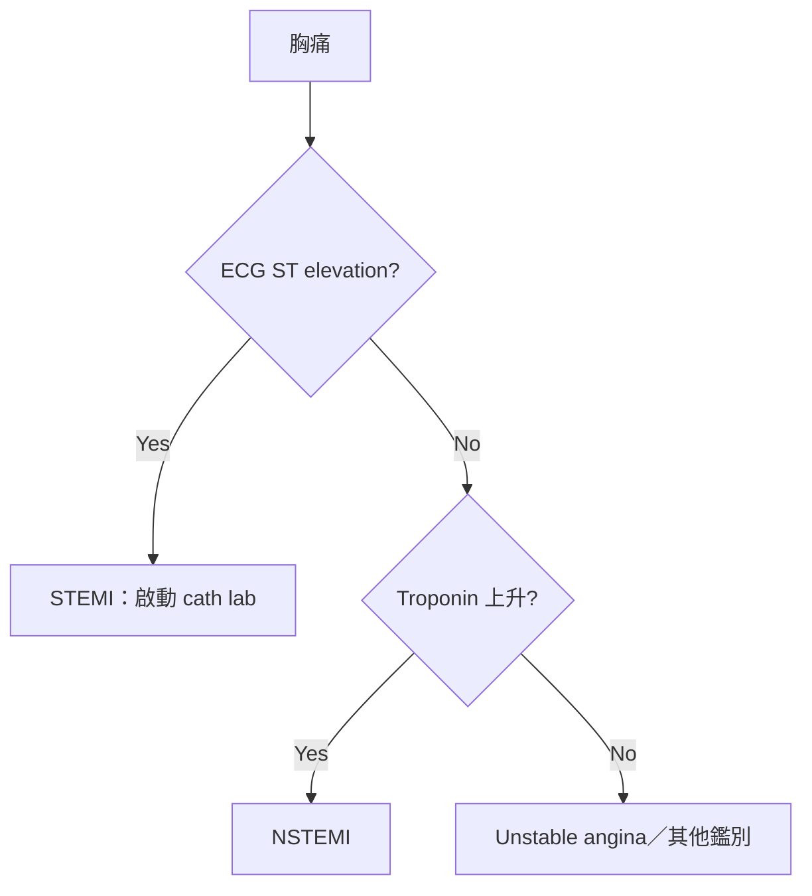
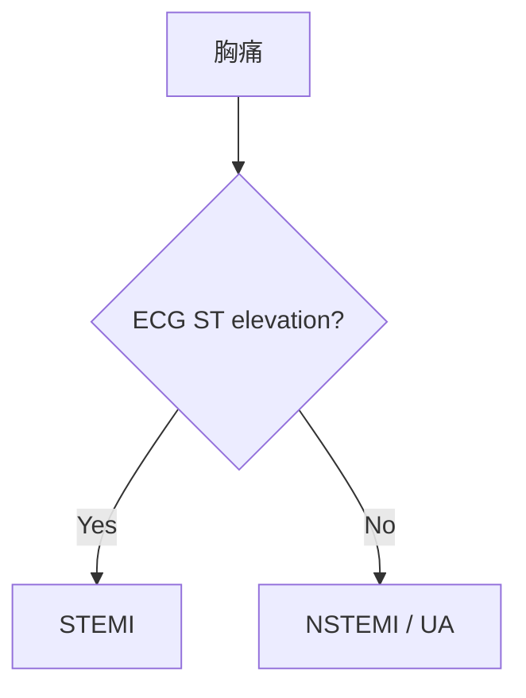

# Obsidian 語法速查表

> [!tip] 使用方式
> 每個範例下面的灰色程式碼框，滑鼠移上去右上角會出現「複製」按鈕，複製後貼到筆記裡改內容就好。

---

## 1. 重點標記

| 效果 | 語法 | 用途 |
| --- | --- | --- |
| **粗體** | `**文字**` | 關鍵字（酒紅色） |
| *斜體* | `*文字*` | 菌名、藥物分類、拉丁文（紫色） |
| ***粗斜體*** | `***文字***` | 必考、危險（鮮紅色） |
| ==螢光筆== | `==文字==` | 考點（黃色螢光筆） |
| ~~刪除線~~ | `~~文字~~` | 過時的觀念、舊指引 |
| `162–325 mg` | `` `文字` `` | 劑量、數值、Lab 正常值 |

```
**關鍵字**　*Staphylococcus aureus*　***必考***　==考點==　~~舊指引~~　`325 mg`
```

---

## 2. 標題

```
# H1 筆記大標題
## H2 章節（藍綠色左邊條）
### H3 小節（醫療藍）
#### H4 子項目（虛線底線）
##### H5
###### H6
```

---

## 3. 清單

**項目符號**
- 第一層
	- 第二層（按 `Tab` 縮排）
		- 第三層

```
- 第一層
	- 第二層
		- 第三層
```

**編號清單**
1. ==Airway==
2. Breathing
3. Circulation

```
1. Airway
2. Breathing
3. Circulation
```

**待辦清單**
- [ ] 還沒做
- [x] 已完成

```
- [ ] 還沒做
- [x] 已完成
```

---

## 4. 醫學 Callout

> [!note] 小提醒
> - `[!類型]` 後面接的文字就是標題，不寫就顯示類型名稱
> - 類型後面加 `-` → 預設**收起**；加 `+` → 預設**展開**但可以收起
> - 中文名稱和英文名稱都可以用

### 💎 臨床珍珠 Pearl

> [!pearl] Clinical pearl
> Inferior wall MI 要先做 **right-sided ECG**，若有 RV infarct ***避免使用 nitrates***

```
> [!pearl] Clinical pearl
> 內容
```

### 🩺 臨床實戰 Clinical

> [!臨床實戰] 急診胸痛處置
> - 10 分鐘內完成 **12-lead ECG**
> - STEMI → 啟動 cath lab，==door-to-balloon < 90 min==

```
> [!臨床實戰] 標題
> - 內容
> - 內容
```

### 🚨 警訊 Red flag

> [!redflag] Red flags
> ***糖尿病、老年人、女性*** 可能以 **atypical presentation** 表現

```
> [!redflag] Red flags
> 內容
```

### 📋 病例 Case

> [!case] 病例
> 65 歲男性，DM 病史，突發胸悶 2 小時伴隨冒冷汗，ECG 顯示 II、III、aVF ST elevation。

```
> [!case] 病例
> 年齡／性別，病史，主訴，PE，Lab，Image
```

### ❓ 問答 Q&A（可折疊，自我測驗用）

> [!qa]- Q：STEMI 的 ECG 定位？
> V1–V4 = anterior、II/III/aVF = inferior、I/aVL/V5–V6 = lateral

```
> [!qa]- Q：問題寫在這裡？
> 答案寫在這裡（點標題才會展開）
```

### 名稱對照

| 類型 | 英文 | 中文 |
| --- | --- | --- |
| 臨床珍珠 | `pearl` | `珍珠`、`臨床珍珠` |
| 臨床實戰 | `clinical` | `實戰`、`臨床實戰` |
| 警訊 | `redflag` | `警訊` |
| 病例 | `case` | `病例` |
| 問答 | `qa`、`Q&A` | `問答` |

### 進階用法

**巢狀 Callout**（病例裡面放問答）

> [!case] 病例
> 25 歲女性，突發呼吸困難，最近開始服用口服避孕藥。
>
> > [!qa]- Q：最可能的診斷？
> > **Pulmonary embolism**，下一步做 CTPA

```
> [!case] 病例
> 病例內容
>
> > [!qa]- Q：問題？
> > 答案
```

**Obsidian 內建 Callout**（也可以用）

`note` 筆記 · `tip` 提示 · `important` 重要 · `warning` 注意 · `danger` 危險 · `question` 問題 · `example` 範例 · `quote` 引用 · `abstract` 摘要 · `todo` 待辦 · `success` 完成 · `bug` 錯誤

---

## 5. 表格

| 藥物 | 機轉 | 副作用 |
| :--- | :---: | ---: |
| Aspirin | COX-1 抑制 | GI bleeding |
| Clopidogrel | P2Y12 抑制 | Bleeding |

```
| 藥物 | 機轉 | 副作用 |
| :--- | :---: | ---: |
| Aspirin | COX-1 抑制 | GI bleeding |
| Clopidogrel | P2Y12 抑制 | Bleeding |
```

> [!tip] 對齊方式
> `:---` 靠左　`:---:` 置中　`---:` 靠右
> 表格裡要打 `|` 的話，寫成 `\|`

---

## 6. 連結與嵌入

```
[[筆記名稱]]                    連結到另一篇筆記
[[筆記名稱|顯示文字]]           連結但顯示別的文字
[[筆記名稱#標題]]               連結到某篇筆記的某個標題
[[筆記名稱#^區塊ID]]            連結到某一段
![[筆記名稱]]                   把整篇筆記嵌入進來
![[筆記名稱#標題]]              只嵌入某個章節
![[圖片.png]]                   插入圖片
![[圖片.png|400]]               插入圖片並設定寬度 400px
[顯示文字](https://網址)        外部網址
```

> [!tip] 小技巧
> 打 `[[` 會自動跳出筆記清單；在某段文字最後加 ` ^abc` 就能用 `[[筆記#^abc]]` 連到那一段。

---

## 7. 標籤與筆記屬性

**標籤**：#cardiology #ACS #考前必看

```
#cardiology #ACS #考前必看 #心臟科/冠心病
```

**筆記屬性**（放在筆記最上面，前後用 `---` 包起來）

```
---
tags: [cardiology, ACS]
aliases: [急性心肌梗塞, AMI, Heart attack]
科別: 心臟內科
複習日期: 2026-10-20
---
```

> [!tip]
> `aliases` 設定別名後，搜尋「AMI」或「急性心肌梗塞」都會找到這篇筆記。

---

## 8. 數學公式

Anion gap = $Na^+ - (Cl^- + HCO_3^-)$

$$
\text{Corrected Ca} = \text{Ca} + 0.8 \times (4 - \text{Albumin})
$$

```
行內公式：$Na^+ - (Cl^- + HCO_3^-)$

獨立公式：
$$
\text{Corrected Ca} = \text{Ca} + 0.8 \times (4 - \text{Albumin})
$$
```

常用符號：`\uparrow` ↑　`\downarrow` ↓　`\rightarrow` →　`\geq` ≥　`\leq` ≤　`\pm` ±　`\times` ×　`\frac{a}{b}` 分數　`x^2` 上標　`x_2` 下標

---

## 9. 流程圖（診斷流程、處置流程）



````

````

---

## 10. 其他

**引用**

> 一般引用文字，適合放教科書原文或指引內容。

```
> 引用文字
```

**分隔線**

```
---
```

**註解**（只有編輯時看得到，閱讀模式會隱藏）

%%這段文字在閱讀模式看不到%%

```
%%這段文字在閱讀模式看不到%%
```

**腳註**（標註參考文獻）

根據 2023 ESC guideline[^1]，建議……

[^1]: 2023 ESC Guidelines for the management of acute coronary syndromes.

```
根據 2023 ESC guideline[^1]，建議……

[^1]: 參考文獻內容
```

---

## 11. 常用快捷鍵（Mac）

| 功能          | 快捷鍵                    |
| ----------- | ---------------------- |
| 粗體          | `⌘ + B`                |
| 斜體          | `⌘ + I`                |
| 插入連結        | `⌘ + K`                |
| 切換 待辦 ☐ / ☑ | `⌘ + L`                |
| 切換 註解       | `⌘ + /`                |
| 縮排／取消縮排     | `Tab` ／ `Shift + Tab`  |
| 切換 編輯／閱讀模式  | `⌘ + E`                |
| 快速開啟筆記      | `⌘ + O`                |
| 命令面板（找所有功能） | `⌘ + P`                |
| 全域搜尋        | `⌘ + Shift + F`        |
| 在這篇筆記中搜尋    | `⌘ + F`                |
| 新增筆記        | `⌘ + N`                |
| 回上一篇／下一篇    | `⌘ + Option + ←` ／ `→` |
| 折疊／展開標題     | 滑鼠移到標題左邊點箭頭            |

### 自訂快捷鍵
> 螢光筆和插入 Callout 預設沒有快捷鍵，可以到「設定 → 快捷鍵」搜尋：
> - 「**Toggle highlight**」→ 建議設成 `⌘ + Shift + H`
> - 「**Insert callout**」→ 建議設成 `⌘ + Shift + C`

